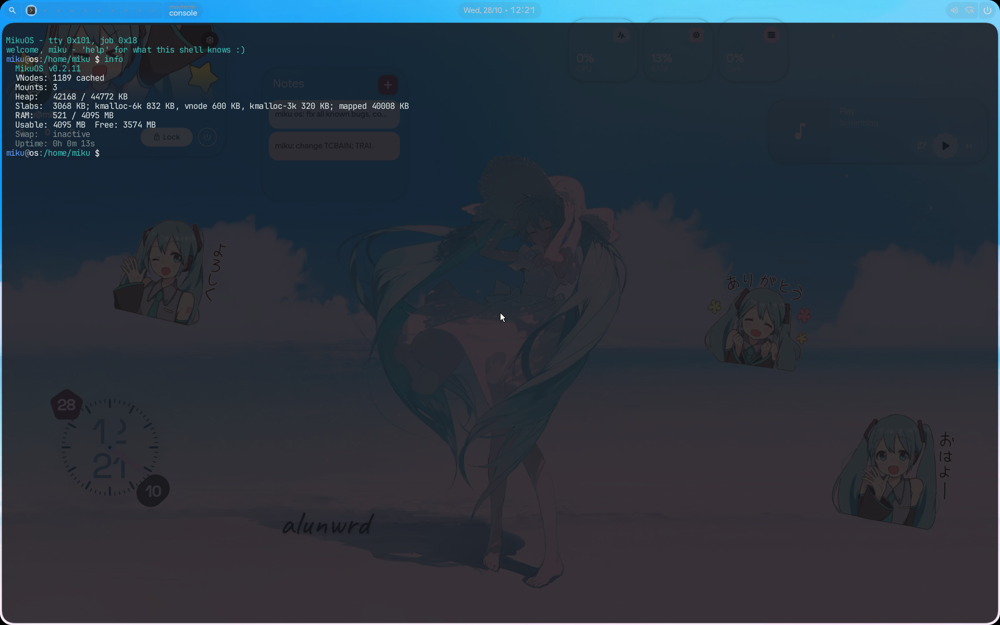
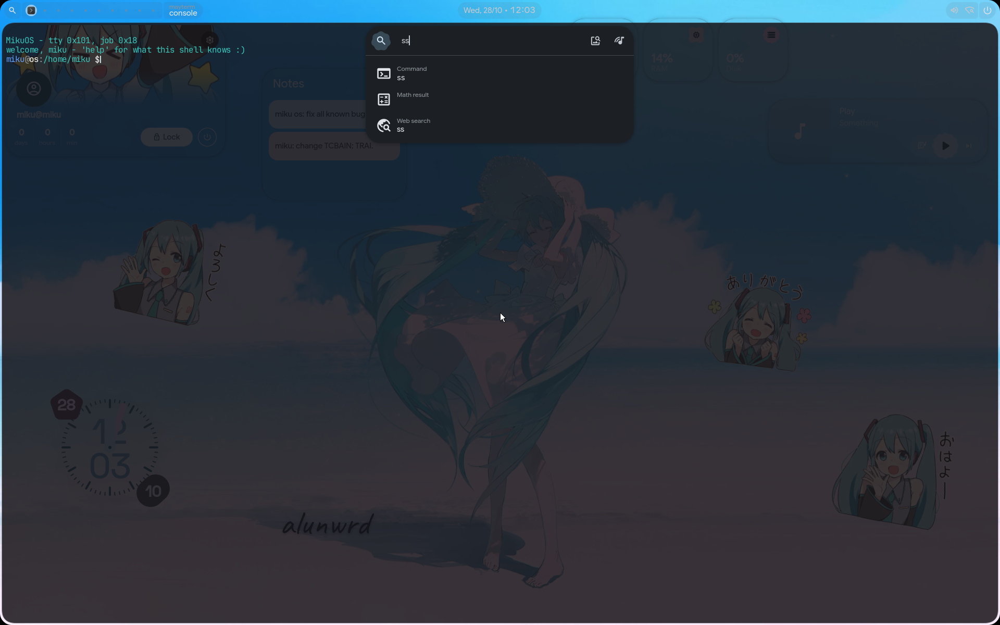

<div align="center">

# Miku OS

**A full-stack x86_64 operating system written from scratch in Rust**

*Powered by Rust and one developer*


[](https://www.rust-lang.org/)
[]()
[]()
[]()
[]()

<div align="center">

### Graphical login (`maygreet`)
<a href="docs/screenshots/login.png">
  
</a>

<br><br>

### The desktop: `aosh` + `maywm`, and `msh` in `mayterm` running `info`
<a href="docs/screenshots/desktop.png">
  
</a>

<br><br>

### The `aosh` launcher
<a href="docs/screenshots/launcher.png">
  
</a>

<p><em>(Taken in QEMU, where the desktop is composed on the processor: shadows, rounded corners and
borders are drawn there too, but the blur and the fades come from the GPU's compute pass on the
RTX 5060 Ti. Click a screenshot for full resolution.)</em></p>

</div>

</div>

---

> **Translations:** [Russian](docs/Russian_README.md), [English](docs/English_README.md), [Japanese](docs/Japanese_README.md)
> **ABI reference:** [MikuOS_ABI.md](docs/MikuOS_ABI.md) · **Security model:** [MikuOS_Security.md](docs/MikuOS_Security.md)
> **NVIDIA:** [GB206 / RTX 5060 Ti](docs/Nvidia_gb206.md) · [TU116 / GTX 1650](docs/Nvidia_tu116.md)
> **Reference documentation:** [WIKI.md](WIKI.md) (the index of [docs/wiki/](docs/wiki/)) · **Working notes (design, decisions, measurements):** [dev/](dev/README.md)

---

## About

**Miku OS** is an operating system built from scratch in a `no_std` Rust environment. There is no C library
beneath the kernel and no host runtime: memory layout, interrupt handling, scheduling, filesystems, drivers,
the display server and the GPU driver are all written here. Programs above it get MikuOS's own C library,
`libc_miku`, written in Rust, and a Rust `std` built on it.

What runs today:

- a preemptive SMP kernel with processes **and threads**, futexes, Linux-shaped signals and a vDSO;
- terminals: pseudo-terminals, sessions, process groups and job control, with the shell (`msh`) in ring 3;
- a VFS over tmpfs, ext2/3/4, btrfs (read-only) and memfs, with a page cache, write-back for disk files
  and inotify;
- a TCP/IP stack in the kernel, and DNS, TLS 1.3 and HTTP in ring 3;
- **Mayland**, a display server and compositor, and a desktop on it: a Hyprland-shaped window manager
  (`maywm`), a terminal (`mayterm`), and **aosh**, a desktop shell written in QML with real JavaScript;
- its own **NVIDIA driver** for the RTX 5060 Ti (GB206, Blackwell): GSP-RM boot, DisplayPort output,
  scanout from video memory, a compute channel that blurs, shades and draws the desktop on the card;
- a **Rust `std` port**: `std::thread`, `std::sync`, `std::net`, `tokio`, `smol` - and the **Zed editor**
  runs on it;
- **its own libc** (`libc_miku.so`, about 540 exported functions, written in Rust) with C headers, so C
  libraries - SQLite, zstd, tree-sitter, FreeType - build and link against it;
- login and elevation **without a setuid bit**, through a broker; Argon2id passwords;
- a package manager (`mikupkg`) and an installer.

> All code is Rust, except the vendored C libraries named above. Assembly appears only in the boot entry,
> the syscall and trap entries, the AP trampoline and the context switch - places where the calling
> convention has to be exact.

**Scale:** ~182 000 lines of kernel in 463 files; ~140 000 lines of libraries (the ext and btrfs drivers,
libmiku, the display protocol, the network protocols, the package manager, the `std` port);
~66 000 lines of programs (`system/`, `utils/`, `aosh/`, `apps/`, `stdapps/`).

---

## Kernel

| Component | Description |
|:--|:--|
| **Architecture** | x86_64, `#![no_std]`, `#![no_main]` |
| **Boot** | GRUB2 + Multiboot2, BIOS boot (under UEFI, GRUB 2.14's `multiboot2` faults). An early console paints each boot phase into the framebuffer before the real console exists. Every boot step prints its name, and its milliseconds when it takes 5 ms or more; the kernel's own boot takes about 115 ms on QEMU/KVM |
| **Address space** | Higher-half kernel at `0xFFFFFFFF80000000`, HHDM direct map at `0xFFFF800000000000` |
| **CPU protection** | NX, WP, SMEP and SMAP on; the direction flag is cleared on every entry from ring 3; the FPU/SSE state is part of every task and saved on switch |
| **Interrupts** | IDT, LAPIC + IO-APIC (the 8259 is masked), MSI and MSI-X for NVMe (a vector per queue), AHCI, virtio-net and the GPU |
| **Timer** | LAPIC timer at 250 Hz, calibrated against the PIT; per-CPU timer queues for nanosecond sleeps and `poll` timeouts |
| **SMP** | Up to 64 CPUs; ACPI MADT, INIT/SIPI, per-CPU GDT/TSS/GS. A TLB shootdown goes only to CPUs that have the address space loaded |
| **Scheduling** | CFS-style vruntime with per-CPU run queues kept as heaps, placement and work stealing, idle polling before `hlt`, up to 32 768 tasks |
| **Kernel heap** | Size-class slabs with per-CPU magazines; anything over 32 KiB comes from `vmap`; shrinkers give memory back under pressure; `slabdebug` checks every object |
| **Kernel stacks** | Mapped in `vmap` with guard pages: 128 KiB for a program's task, 512 KiB for a kernel thread |
| **Syscalls** | 124 (0-123, all assigned) through `SYSCALL`/`SYSRET`; `sigreturn` returns through `iretq` |
| **vDSO** | `clock_gettime`, `gettimeofday` and `getcpu` without a syscall (`Instant::now` costs 11 ns) |
| **Clock** | CMOS at boot; `mikudo ntpdate` or `clock_settime` sets it (there is no automatic NTP sync) |
| **Kernel log** | Leveled records in memory (`klog`), three rings by level so chatter never pushes an error out, read by `dmesg`; `pstore` keeps chosen lines across a warm reboot (the whole log with `klogpstore`); backtraces carry symbol names |

### Locks and waits

- **`SchedMutex` / `SchedRwLock`** (`kernel/kcore/sched_lock.rs`) spin briefly, then sleep. The VFS lock
  and the page cache's are read-write: `stat`, `open`, `getdents`, `close` and cached reads run beside each
  other. Descriptor reads take no lock at all (a sequence count per slot).
- **`IrqMutex`** for anything an interrupt handler touches; the timer handler takes no lock at all.
- **Wait queues** everywhere a task waits. No wait checks a condition and then sleeps on it separately:
  that is the lost wakeup, and each one found was a 100 ms stall.
- **`/proc/lockstat`** (with `lockstat` on the boot line): how often each sleeping lock was taken and
  contended, its hold times by bucket, the longest hold and where it was taken, and the disk reads and
  writes made while the VFS lock was held.

### Memory safety of the kernel itself

Each of these exists because it caught a real, hard-to-diagnose bug:

- **Stack guard pages** - an overflow faults at the instruction that did it, and the fault names the task.
- **`slabdebug`** - poisoned, red-zoned objects: a write past the end, a double free and a write after
  free are each reported where they happen.
- **`IrqMutex`** - a plain spin lock taken by an interrupt handler deadlocks a CPU against itself.
- **Copy-on-write read-only until the shootdown** - a sibling CPU can never write through a stale entry.

---

## Memory management

| Part | Detail |
|:--|:--|
| **Physical** | Bitmap sized by the highest usable frame; copy-on-write counts are one atomic per frame; per-CPU frame caches for faults |
| **Virtual** | Four-level paging behind `AddressSpace`; kernel half shared by every address space |
| **Faults** | Demand paging with fault-around (16 pages when the page before is mapped); copy-on-write across `fork` |
| **mmap** | Anonymous (private only), file-backed, `MAP_SHARED` of a file (a tmpfs file's own frames), `mprotect`, `msync` |
| **Swap** | Reverse map, clock-sweep eviction with aging, swap PTEs that keep the original flags; reclaim on the **kswapd** thread. One swap device of up to 256 MiB, and only frames in the first 256 MiB of physical memory can be swapped out |
| **Page cache** | A disk file's pages, read without the VFS lock on a hit, written back by bdflush, `fsync` or the dirty limit |

---

## Processes, threads and signals

| Feature | Detail |
|:--|:--|
| **Model** | A task per thread; threads of a process share a thread group (`tgid`) whose descriptors, memory and credentials resolve through the leader |
| **Creation** | `fork` (copy-on-write), `exec`/`execve`, `wait4` with a POSIX status word, `thread_create`/`thread_exit`, `gettid` |
| **Thread limits** | No `clone` with flags; `exec` from a thread other than the leader is refused |
| **Synchronisation** | `futex` (wait, wake, timeouts; a `MAP_SHARED` tmpfs page is keyed on its frame, so it works across processes), so `std::sync` needs no MikuOS code. No requeue, priority inheritance or robust lists |
| **Signals** | Signals 1-31 with Linux's `siginfo_t` and `ucontext_t` layout: a handler gets the whole machine and may rewrite it (wasmtime does). `SA_RESTART` is accepted but not acted on. CPU faults are signals - `#PF` is `SIGSEGV`, `#UD` is `SIGILL`, `#DE` is `SIGFPE` - and `sigaltstack` is per thread |
| **Terminals** | Sessions, process groups, controlling terminals, `SIGTTIN`/`SIGTTOU`, job control |
| **When a program dies** | A crash report names the fault and the stack with symbols; an ELF core lands in `/tmp` for a debugger |
| **ELF loader** | Hardened against hostile images; a selftest builds them in memory |
| **Credentials** | uid/gid, supplementary groups, capabilities (`capget`/`capset`), sessions as kernel objects |

---

## System calls

124 numbers (0-123, all assigned); the full table with arguments and errors is in [MikuOS_ABI.md](docs/MikuOS_ABI.md).

| Range | Area |
|:--|:--|
| 0-17 | `exit`, `write`, `read`, `mmap`, `munmap`, `mprotect`, `brk`, `getpid`, `getcwd`, TLS, `open`, `close`, `seek`, `fsize`, `map_lib`, `sleep`, `uptime` |
| 18-42 | files: `stat`, `fstat`, `mkdir`, `rmdir`, `unlink`, `readdir`, `rename`, `link`, `chmod`, `chown`, `dup`, `dup2`, `write_file`, `truncate`, `symlink`, `readlink`, `pipe`, `chdir`, `statfs`, `fallocate`, xattrs, `utimensat`, `fsync`, `punch_hole` |
| 43-55 | `fork`, `wait4`, `kill`, `exec`, `umask`, uid/gid calls |
| 56-59, 62-66, 77, 80, 83-85, 114 | sockets: `socket`, `connect`, `send`, `recv`, `bind`, `listen`, `accept`, `sendto`, `recvfrom`, `socketpair`, socket options, `peercred`, `sendfd`/`recvfd` |
| 60-61, 67-71 | `mmap_file`, `msync`, `execve`, `sigentry`, `sigreturn`, `clock_gettime`, `ioctl` |
| 72-76, 78-79, 81-82 | display pools, `klog`, `poll`, `getrandom`, `clock_settime`, xattr list/remove |
| 86-93 | `setresuid`, `setresgid`, `setgroups`, `getgroups`, `capget`, `capset`, `session`, `power` |
| 94-98, 121 | GPU: `gpu_info`, `gpu_submit`, `gpu_bind`, `gpu_wait`, `gpu_program`, `gpu_alloc` |
| 99-105 | `tty`, `sigdisp`, `setpgid`, `getpgid`, `procinfo`, `kcmd`, `proc_path` |
| 106-120 | threads (`thread_create`, `thread_exit`, `gettid`, `sched_yield`, `futex`), `getdents`, `lstat`, `fcntl`, `getsockopt`, `sigaltstack`, inotify (116-118), `realpath`, `pipe2` |
| 122-123 | `sleep_ns`, `poll_ns` |

The high half of a path argument's length names a directory descriptor - that is how the `*at` calls,
`fchmod` and `F_GETPATH` are expressed; an empty path with a descriptor names the descriptor's own file. Every user pointer is checked page by page, and paths are copied
into the kernel before use.

---

## Virtual file system

| Property | Value |
|:--|:--|
| Vnodes | A dynamic table with an LRU and a shrinker; reclaimed in batches |
| Names | Directory entries are their own objects: hard-link aliases, an inode cache, negative entries, whiteouts; inode numbers are stable |
| Open files per process | 512 |
| Name length | 255 bytes |
| tmpfs | Frames, up to a quarter of RAM; 4 GiB files |
| Filesystem types | tmpfs, devfs, procfs, ext2, ext3, ext4, btrfs (read-only), memfs |

- **Filesystems behind one trait** (`FileSystem`) and one registry; nothing in the VFS names a format.
- **Lookups without the lock**: a name the cache does not have is read from the disk with the VFS lock let
  go, then put in if the directory has not changed meanwhile.
- **Page cache for disk files**: a cached read takes no VFS lock; writes go into it as dirty pages and are
  written out by `fsync`, bdflush (pages older than five seconds) or a writer over the dirty limit. A big
  file's blocks and pages are freed after the lock, not under it.
- **inotify** with Linux's ABI; pipes are anonymous vnodes; POSIX record locks (`fcntl`).
- `/proc` has twelve files: `version`, `uptime`, `meminfo`, `mounts`, `cpuinfo`, `stat`, `heap`, `diskstats`,
  `net`, `clock`, `slabinfo` and `lockstat`. There are no per-process directories.

---

## Filesystems

### ext2 / ext3 / ext4 (`lib/fs/extfs`, mounted by `kernel/fs/ext/`)

The driver is a separate crate that knows the on-disk format and nothing about this kernel: it reaches the
disk through one trait (`BlockHost`, from `lib/fs/fshost`). The point is the test loop - `cd lib/fs/extfs &&
cargo test` builds a filesystem in memory, corrupts it on purpose, cuts the power mid-transaction and
checks what the driver does, in seconds rather than a boot.

| Capability | Detail |
|:--|:--|
| **Read** | Direct, indirect, double- and triple-indirect blocks; ext4 extent trees; inline data |
| **Write** | Extents allocated and freed in runs; file data goes straight to the device, a new block's data before the extent that names it; blocks freed by an open transaction are not reused until it commits |
| **Directories** | Hash-indexed (`dir_index`) read and written: index built on growth, leaves split at a hash boundary, the tree gains a level |
| **ext3 journal** | JBD2: transactions with handles, descriptor and revoke blocks, write-ahead ordering by pinning, replay on mount, orphan list, crc32c over the log |
| **ext4** | Extent trees of any depth, unwritten extents for `fallocate`, the `64bit` feature (block numbers are still 32-bit inside), flex_bg, nanosecond and post-2038 times |
| **Checksums** | crc32c (SSE4.2 when present) over every metadata structure |
| **Integrity** | A five-pass check and repair (`extfsck`), orphan cleanup, TRIM, `fiemap` |
| **mkfs** | ext2/ext3/ext4, ext4 with `metadata_csum` |

Checked against e2fsprogs, not against itself: `e2fsck -f -n` on every image the tests make, checksums
reproduced from `mke2fs` images, a directory index `e2fsck -D` built written into and walked by `debugfs`,
and a power cut at every write of an operation with each resulting image handed to `e2fsck`.

### btrfs (`lib/fs/btrfs`)

Read-only in the kernel: chunk tree, the filesystem trees, extents, inline files. The crate also has
copy-on-write transactions, an allocator and commits, tested on the build host against `mkfs.btrfs`
images.

### Others

- **tmpfs** - the root filesystem; **memfs** - a mounted filesystem with no medium, used to test the VFS
  against a second format; **devfs**, **procfs**
- **GPT** - partition table parsing, partition nodes, `partprobe`
- **Installer** - `install plan` / `install go` in the console, or a window that asks the same questions

---

## Storage stack

```
VFS → page cache → filesystem → block layer (cache, bdflush) → driver → device
```

- **Block layer** (`kernel/io/block/`): device registry, partitions, per-device statistics, discard and
  write-zeroes, health (NVMe log pages, ATA SMART), `/proc/diskstats`
- **Drivers** (`kernel/drivers/block/`): `nvme` (an I/O queue per CPU, an MSI-X vector per queue), `ahci`
  (MSI), `ata` (PIO + bus-master DMA), `virtio_blk`, `ramdisk` (the firmware image GRUB hands over).
  A waiter polls for 50 µs and then sleeps.

---

## Network stack

| Layer | Support |
|:--|:--|
| **Drivers** | Intel e1000 family, Realtek RTL8139 and RTL8111/8168 (PCI id 8169 is handed to the RTL8139 driver), virtio-net (transitional id 1af4:1000) with MSI-X |
| **Link / network** | Ethernet, ARP, IPv4, ICMP |
| **Transport** | UDP; TCP with retransmission and listeners (no `TIME_WAIT` or `CLOSING` state yet); RFC 6056 port selection |
| **In ring 3** (`lib/net`) | DNS (`getaddrinfo`), HTTP/1.1, HTTP/2, NTP, a TLS 1.2/1.3 client with certificate validation against the roots in `/etc/ssl/certs/ca-bundle.pem` - no trust store means no connection |
| **Sockets** | AF_INET (TCP, UDP, raw ICMP), AF_UNIX with `peercred` and descriptor passing, AF_MAYLAND |

`netd` runs DHCP at boot. `ping`, `traceroute`, `wget`, `curl`, `host` and `ntpdate` are programs in `/bin`.
There is no loopback interface, and `shutdown`, `getsockname` and `getpeername` are not implemented yet.
The full reference is [docs/wiki/network.md](docs/wiki/network.md).

---

## Graphics: Mayland, the desktop and the GPU

### Mayland (`kernel/mayland/`, `lib/gfx/mayland/`)

A display server and compositor. Its protocol uses Wayland's wire format over its own socket family;
shared memory is a kernel handle, the keymap a table. One copy of the protocol and the font renderer is
compiled into both the server and every client (`libmay`).

- **Compositing**: damage tracking, windows with rounded squircle corners, borders, shadows and blur,
  animations on curves, the afterimage of a closing window, layers above and below windows, popups,
  the clipboard, a hardware cursor plane.
- **Window management** is a program: **`maywm`** reads a Hyprland-shaped config (`/etc/mayland/default.d/*.conf`, then `may.conf`, then
  `conf.d/*.conf`; a later line wins): tiling,
  workspaces, rules, binds, `exec-once`, monitors. A line nobody recognised is reported, not dropped.
- **Outputs**: modes from the monitor's EDID; the desktop is composed on one output (a second head is
  written but has not run yet); a display layer (`kms`) above the drivers
  takes atomic, test-first requests, and `maywm`'s `monitor =` lines are Hyprland's.
- **Clients**: `mayterm` (a window that hosts a shell on its own pty), `maygreet` (the login screen),
  `maysession`, the installer, `maydemo`, Zed.

### aosh - the desktop shell (`aosh/`, `etc/aosh/`)

aosh is to MikuOS what quickshell is to Hyprland: one program that reads a directory of QML files and draws
the bar, the launcher, the overview and the popups from them. The language is a subset
of QML; every expression and function is real JavaScript (QuickJS). Text is rendered with FreeType and
rustybuzz and matches Qt's glyphs pixel for pixel; rectangles, glyphs, Canvas and effects
render the way Qt Quick renders them (within 1-2/255 of Qt) - on the card through a compute program, on
the processor otherwise. It ships with a port of a real quickshell configuration (`etc/aosh/negi`, run
with `aosh -c negi`). Your own config goes in `~/.config/aosh`, because `/etc` is the read-only boot
image. See [docs/wiki/aosh.md](docs/wiki/aosh.md) and [docs/wiki/mayland.md](docs/wiki/mayland.md).

### On the card

On the RTX 5060 Ti the compositor runs on the GPU's compute engine: blur, shadows, rounded corners and
window composition are GPU programs, every window is kept in video memory (copied there by the copy
engine; `notex` turns this off), and aosh's own drawing is a GPU program too. A surface the compute pass
cannot take is blended by the processor. That is the driver's job, below.

---

## NVIDIA GPU driver (`kernel/drivers/gpu/nvidia/`)

A driver of its own for the **GeForce RTX 5060 / 5060 Ti (GB206, Blackwell)**, about 52 000 lines in 130
files, written by reading the published `nvidia-open` source (OpenRM) function by function. It is not a
port: no C, no Linux shims. It boots the card's GSP-RM firmware and talks to it the way OpenRM does, and
the display, memory and compute paths above that are this kernel's own. The design notes are in
[`dev/`](dev/README.md) (`gsp-foundation.md`, `gsp-615.md`, `gb206-display.md`, `gpu-memory-compute.md`,
`kms-architecture.md`, `gpu-perf.md`); the user-facing notes are [Nvidia_gb206.md](docs/Nvidia_gb206.md).

### Bring-up

```
PCI probe → BAR0/BAR1 → FSP chain of trust (MCTP over EMEM) → GSP-FMC → GSP-RM 615 running
          → RPC transport up → system info, registry, static info → RM object tree → engines
```

- **FSP boot** (`blackwell/fsp.rs`, `fmc.rs`, `gspboot.rs`): on Blackwell the host does not run the falcons
  itself. It stages GSP-FMC and the GSP-RM image in system memory and sends the FSP one chain-of-trust
  message; FSP verifies FMC, FMC carves the protected region and starts GSP-RM.
- **One firmware release**: the driver speaks GSP-RM **615.78.08** - the firmware and the code that talks to
  it come from the same release, as in OpenRM. GSP-RM and the ucodes are extracted from NVIDIA's driver
  package, and FMC and the bootloader are built from OpenRM 615.78.08's bindata (`dev/nvidia/fw_extract.py`
  with `--tree refsrc/openrm`); all of it is packed into an ext2 image and handed over as a GRUB module.

### Talking to GSP-RM (`gsp_common/`)

- **Transport** (`rpc/`): the 615 message queue (MSGQ 2.0 with MCTP/NVDM framing), one receive path with
  OpenRM's boot allow-list, header checks (MCTP version, vendor, magic, size), replies matched by function
  and sequence, and a sanity check before every call.
- **Lifecycle** (`kgsp/`): an interrupt handler that only touches atomics and a worker thread as its bottom
  half; events, health checks, **unload and reload without rebooting the machine**, CrashCat reports.
- **RM API** (`rmapi.rs`): every object is allocated through an RM client with real parents - client,
  device, subdevice, memory, channels, display - the tree GSP-RM expects.
- **Logs**: GSP-RM's own log is decoded (`logdecode.rs`); every RPC and RM call with its status goes to the
  kernel log at debug level, robust-channel errors, Xids and CrashCat at error level (`nvidia log`).

### Memory

- **GPU MMU of its own** (`gmmu.rs`, `vaspace.rs`): page tables built here, with 4K, 64K and 2M pages and
  TLB invalidation; BAR1 mapped for the processor's stores into video memory.
- **Video-memory allocator** (`gsp_common/vram.rs`) and **pools a program can map** (`gpu_alloc`): a window
  whose buffer is video memory is read in place by the compositor - MikuOS's DMA-BUF.

### Channels, copies and compute

- GPFIFO channels with push buffers and semaphores; a **copy engine** for uploads and window copies; a
  **compute channel** that launches programs through QMDs (`qmd.rs`), several of them in one submission.
- **GPU programs** are CUDA C (`shaders/*.cu`: blur, composite, fill, over, paint), compiled by `nvcc` at
  build time and read by MikuOS's own cubin parser (`cubin.rs`) - the same parser checks them at build time
  and loads them in the kernel.
- **User programs**: `gpu_program` (98) loads a program a process supplies, under `CAP_GPU`; `gpu_submit`,
  `gpu_bind`, `gpu_wait` and `gpu_info` complete the interface (`apps/gpudemo`).

### Display (`blackwell/display.rs`, `gsp_common/modeset/`, `kernel/drivers/gpu/kms/`)

- **DisplayPort** link training, **HDMI**, IMP (the display's bandwidth and clock check), heads and
  windows, scanout out of video memory, modes from the monitor's EDID.
- **The colour pipeline**: input LUT, colour-space conversion, output LUT, dither and clamp, in hardware
  order. The input LUT is half-float - the screen was black for weeks while it was written as 16-bit fixed
  point.
- **Cursor plane** by default, window flips with a flip semaphore; a **second head** and VRR are written
  but have not run on a panel yet.
- **KMS** (`kms/`): a layer above the driver with DRM's objects and atomic, test-only requests; outputs are
  named as nvidia-drm names them (`DP-1`, `HDMI-A-1`), so a Hyprland `monitor =` line works unchanged
  (QEMU-verified; not yet run on the card).

### Power and clocks (`gsp_common/perf/`)

The firmware reclocks the card; the driver reads what it reports - clocks, load, power and temperatures
from the page GSP-RM writes them into, and the PMU's history - and asks for boost, a clock lock or a floor
the way the client OS does in OpenRM.

### Diagnostics and escape hatches

- `run=nvidia_selftest` - 184 cases, headless; `run=` also drives an unattended **GSP unload/reload test**
  whose log survives a warm reboot (`pstore`).
- Kernel shell: `nvidia` (`gb206`, `log`, `perf`, `rm-tree`, `gsp unload` / `gsp load` / `gsp reset`,
  `selftest`), `display`, `mayland status`. Every subcommand is in
  [Nvidia_gb206.md](docs/Nvidia_gb206.md#commands).
- GRUB flags: `nogpu` (leave the card alone), `nointr` (every GPU wait polls), `nononstall` (fences poll),
  `nobar1` (stores through PRAMIN), `gpu4k` (4K pages only), `notex` (windows read from system memory),
  `nohwcursor` (software cursor), `noflipsema`, `nobackdrop` (no backdrop blur), and the boot-order hatches
  `gspbase`, `pciebase`, `coldhead` and `edidbase`. The complete table is in
  [Nvidia_gb206.md](docs/Nvidia_gb206.md#boot-flags).

### Turing

The **TU116 / GTX 1650** path (`turing/`) does host bring-up and stages the GSP-RM image at boot. The full
six-stage GSP-RM boot (FWSEC, WPR2, SEC2, booter) runs only on request (`nvidia gsp-rm-boot-full`) and is
not expected to finish yet; it has never run on a Turing card. TU117 gets host bring-up only. It has no
display or compute ([Nvidia_tu116.md](docs/Nvidia_tu116.md)).

---

## Input and terminals

- **Keyboard** - PS/2 and USB HID (xHCI, a HID report parser); layouts of its own; key repeat from the
  hardware's typematic (PS/2 only: a held key on a USB keyboard does not repeat yet).
- **Mouse** - PS/2 and USB.
- **Terminals** (`kernel/io/tty/`) - a pty table with masters as descriptors (`/dev/ptmx`, `/dev/ptsN`),
  `termios` per terminal (canonical and raw modes, echo, signal characters), window sizes, `/dev/tty`,
  hangup. Eight terminals in all: the console and seven ptys. See
  [docs/wiki/input-and-terminals.md](docs/wiki/input-and-terminals.md).
- **Console** - a framebuffer text console that never reads the framebuffer back, mirrored to the serial
  port. When the desktop is up the kernel console is serial only; panics still paint.

---

## mikuD - init daemon

PID 1: a kernel thread with a fixed table of 32 services. It owns their lifecycle, dependencies and restarts.

| Concept | Values |
|:--|:--|
| **Targets** | `SysInit`, `MultiUser`, `Graphical`, `Rescue` |
| **Restart policies** | `Always`, `Never`, `OnFailure`, `OnSuccess`, `OnAbnormal` |
| **Service entry** | A kernel `fn()` or the path of an ELF program (on a default boot `/bin` is the read-only GRUB module) |
| **Extras** | Dependency graph, ordering, restart delays, masking, journal, `.service` unit files, `User=` and `Capabilities=` applied before the service's first instruction. Watchdogs and `Type=notify`: a service reports in with `mikuctl notify --ready`/`--watchdog`. `*Sec` times are seconds (`ms`, `s`, `min` suffixes). Timer units and socket activation exist in the code, but nothing can drive them yet |

Services started at boot: `kbd`, `usbd` (not with `nousb`), `netd`, `bdflush`, `kswapd`, `mikudod`, `shell`,
and on the graphical target `compositor` and `greeter`. The full reference is
[docs/wiki/system.md](docs/wiki/system.md).

---

## Userspace

### Rust `std` (`lib/sdk/rust-std/`)

A `std` for `target_os = "miku"`: the platform layer calls `libmiku` rather than the syscalls, so one
library knows the numbers. `fs`, `path`, `env`, `io`, `process`, `net`, `time` (through the vDSO),
`thread`, `sync` (on the futex) and `thread_local` work; `tokio`, `smol` and `polling` run on `poll`.
`target_family = "unix"` is declared, so crates that branch on `unix` build. Programs in `stdapps/` are
the test suites (`stdfs`, `stdthreads`, `stdtokio`, `stdpty`, `stdwatch`, `stdsignal`, ...) and
`stdbench`, which builds for Linux too so the two can be compared. Not there yet: IPv6, `File::lock`,
socket timeouts, `shutdown`, `local_addr`/`peer_addr` and binding port 0.

**Zed** - the editor - builds for MikuOS from its own source with a few patches and a fourth gpui backend
that speaks Mayland. It ships as a package in the image and starts from the desktop.

### libc and C (`lib/runtime/libmiku/`, `lib/sdk/c/`)

**`libc_miku.so`** is MikuOS's C library, written in Rust: about 540 exported functions (about 1450
across all ten `miku` libraries). It covers
`stdio` (`printf`/`scanf` families, `FILE`), `string`, `stdlib`, `ctype`, `math`, `malloc` on the binned
heap, `time`/`ctime`, `dirent`, `poll` and `select`, sockets and `getaddrinfo`, `termios` and ptys
(`openpty`, `posix_openpt`, `login_tty`), `pwd`/`grp` with `getgrouplist`, the `*at` calls, `setjmp`/
`longjmp`, `getauxval`, and POSIX threads - `pthread_create`, mutexes (process-shared too), condition
variables with a clock, rwlocks, `pthread_once`, keys, `pthread_atfork`. Not there yet: `dlopen`, `posix_spawn`, `epoll`,
`eventfd`, `signalfd`, `timerfd` and locales; `getaddrinfo` is IPv4 only and `localtime` is UTC.

`lib/sdk/c/include/` holds the C headers for it - 47 of them, from `stdio.h` to `sys/socket.h` and
`pthread.h`. They are its C face, not a second libc: a header declares only what the library defines, so
a C program that uses something MikuOS lacks fails to compile, and every struct layout is pinned to the
Rust `libc` overlay by `_Static_assert`s, checked whenever a header changes. `lib/sdk/c/miku-cc` wraps the host clang with the
target's flags. SQLite, zstd, tree-sitter and FreeType are built this way, and Rust crates that compile C
through `cc` use the same wrapper.

### Dynamic linking

`ld-miku` is the dynamic loader: relocations, `DT_NEEDED`, the program's own TLS (`PT_TLS`; a library
with TLS cannot load yet), a full auxv, and the auxv handed to libmiku before any constructor runs. There
is no `dlopen`, and the search path is fixed (`/lib`, `/usr/lib`, `/usr/local/lib`). The `miku` libraries are preloaded at `/lib` and shared between
processes: `core_miku`, `sys_miku`, `text_miku`, `ds_miku`, `algo_miku`, `codec_miku`, `fs_miku`,
`net_miku`, `parse_miku`, `libc_miku`. The ring-3 heap uses segregated bins with per-thread caches.

### Users and privilege

MikuOS boots to a login: a graphical one when there is a screen to draw it on, and the console asking
who you are when there is not - the same login, through the same broker, drawn in text.

**There is no setuid bit on this system, no setgid bit, and no file capabilities.** `exec` reads a
file's mode bits and the loader ignores them, so privilege is granted by a privileged process to a child
and never acquired from a file. That removes the whole class of bugs that `sudo`, `doas` and `pkexec`
have spent thirty years having; [MikuOS_Security.md](docs/MikuOS_Security.md) names the advisories.

Elevation is a broker: `/bin/mikudo` runs as you, with no authority, and asks `/bin/mikudod` - started by
mikuD - over a local socket; the kernel names the caller through `peercred`. The login screens are clients
of the same broker: `login` and `maygreet` run as the unprivileged `greeter` account, and `mikudod` is the
only process that reads `/etc/shadow` and spends the Argon2id.

```
login: miku
password for miku:

Welcome, miku.
miku@os:/ $ id
uid=1000(miku) gid=1000(miku) groups=1000(miku),10(wheel),100(users)
miku@os:/ $ cat /etc/shadow
  /etc/shadow: permission denied
miku@os:/ $ mikudo id
[mikudo] password for miku:
uid=0(root) gid=0(root) groups=0(root)
```

A session is a kernel object: an identity, a seat and the process that leads it. It holds one capability,
`CAP_MAY_PRIV`, that follows the seat: the greeter has it while nobody is logged in, and the kernel takes it
away the moment somebody is. While the greeter is up the compositor pins focus to it and every window
manager chord is inert. The home directory is made from `/etc/skel` when a graphical session first starts.

Programs: `mikudo`, `mikudod`, `login`, `maygreet`, `maysession`, `passwd`, `id`, `su`, `useradd`.
The hash and every parser are in `lib/admin/mikuauth`: `cargo test` runs about a hundred cases, including RFC 9106's
Argon2id tag.

### Packages (`lib/admin/mikupkg`, `/bin/mikupkg`)

A container format, a resolver, and a transaction with a journal that rolls back, never forward. The
applier's only contact with the world is a `Root` trait, so the builder installs packages into the image
with the same code `/bin/mikupkg` uses on the machine. Packages are signed (ECDSA P-256). There is no
repository to fetch from yet, and a change to the installed system needs a writable root (`rootrw`).

### Shells

- **`msh`** - the shell, in ring 3 on a pty: quoting, pipes, redirects (`2>` too), `;`, `&&`, `||`, background
  jobs and job control, line editing. It has no variables, globbing or control flow; a name it cannot
  find in `/bin` goes to the kernel console (`kcmd`). See [docs/wiki/msh.md](docs/wiki/msh.md).
- **The in-kernel shell** - the emergency console. It still holds the commands that reach kernel internals
  with no syscall: ext tools (`extfsck`, `extinfo`, ...), `mount`, `gpt`, `mkfs.ext*`, swap, `smart`,
  `fstrim`, `sv` for services, `nvidia` and `mayland` subcommands, `install`, and the selftests. Its output
  goes to the terminal, not to fd 1, so `>` does not capture it. Every command is in
  [docs/wiki/commands.md](docs/wiki/commands.md).

---

## Tests and diagnostics

- **Selftests in the kernel**, run headless from the boot line: `run=vfs_test;ext_test;poweroff`. Suites
  for memory, IPC, VFS, ext, btrfs, terminals, the ELF loader, credentials, the network, the kernel log,
  Mayland and the NVIDIA driver, and the `std` programs. The output goes to the serial port. See
  [docs/wiki/testing.md](docs/wiki/testing.md).
- **Host tests**, no boot: `lib/fs/extfs`, `lib/fs/btrfs`, `lib/net` (X.509, every parser), `lib/crypto`, `lib/base`,
  `lib/admin/mikuauth`, `lib/gfx/mayland` (`cargo test-host`), the kernel heap (`kernel/mm/heap/hosttest`),
  libmiku's heap (`lib/runtime/libmiku/hosttest`), `lib/admin/mikupkg`, `lib/fs/fshost`, `lib/gfx/freetype` and `aosh`
  (`cargo test-host`), `builder`.
- **`stdbench`** - the same benchmark on MikuOS and on Linux. On QEMU/KVM with 4 vCPUs against Linux on
  the bare machine: a process spawn and wait 0.27 ms (Linux 0.63), `Instant::now` 11 ns (20), a pipe round
  trip between processes 2.1 µs (6.8), `read_dir` 145 ns a name (130-142), `stat` 4.7 M/s on four threads.
- **Escape hatches on the GRUB line** - `noauth` (a root console, no login), `nosmap`/`nosmep`, `nointr`
  (GPU waits poll), `nogpu`, `writethrough` (no write-back), `vfsmutex` (no read-side VFS lock),
  `nopagecache`, `nvmepoll`, `netpoll`, `lockstat`, `slabdebug`, `trace`; the full list is in
  [docs/wiki/boot.md](docs/wiki/boot.md).

---

## Build and run

### Requirements

| Tool | Purpose |
|:--|:--|
| Rust nightly + `rust-src` | `build-std` for the bare-metal and the userspace targets |
| clang | The C libraries, through `lib/sdk/c/miku-cc`; aosh needs it, so the build does too |
| LLVM (`llvm-ar`) | Archives for the C libraries |
| `nm` (binutils) | The builder checks that every function a C header declares is defined |
| CUDA toolkit (optional) | `nvcc` compiles the GPU programs (`sm_120`); without it the kernel builds and says they are unavailable |
| `grub-mkrescue`, `xorriso`, `mtools` | ISO creation; GRUB's `i386-pc` files are also used by the in-system installer |
| `qemu-system-x86_64` | Running |
| `e2fsprogs` (`mke2fs`, `debugfs`) | Root image and firmware staging |

### Build everything

```bash
cd builder
cargo run --release
```

The builder builds `ld-miku`, the vDSO, the libraries, the userspace programs (`system`, `utils`, `apps`,
`stdapps`, `aosh`), installs them as packages into the root image, builds the kernel, packs the firmware
image and creates `miku-os/miku-os.iso`. It asks its questions with a timeout each: low-RAM mode, whether
to build the `std` programs in `stdapps` (crate sources cargo has cleaned away are downloaded again;
aosh is built either way), the size of `miku-os/disk.img` (which it creates or refreshes), a data image,
and whether to launch QEMU. `MIKU_FW=` limits the firmware image to one card's files. Zed is built
separately: `cargo run --release -- zed build -p zed` in `builder/`; `cargo run --release -- std <crate>`
builds any one `std` crate. The whole build is described in [docs/wiki/building.md](docs/wiki/building.md).

### Run

```bash
qemu-system-x86_64 -enable-kvm -cpu host -smp 4 -m 4G \
  -boot d -cdrom miku-os/miku-os.iso \
  -serial stdio \
  -netdev user,id=n0 -device virtio-net-pci,netdev=n0
```

Add `-drive file=<image>,format=raw,if=virtio` for a disk. A disk is mounted as the root only with `root=`
on the boot line, and written to only with `rootrw`. The GRUB menu has one entry;
a flag such as `noauth`, `nointr` or `nogpu` goes on one boot with `e` there, and every flag is listed in
[docs/wiki/boot.md](docs/wiki/boot.md).

### Write to a USB stick

```bash
sudo dd if=miku-os/miku-os.iso of=/dev/sdX bs=4M status=progress conv=fdatasync
```

Boot it in legacy BIOS (CSM) mode, because under UEFI GRUB's `multiboot2` faults. Building with `MIKU_FW=`
set to the value the kernel prints keeps only that card's firmware: with `nvidia/gb206` the ISO goes from
143 to 114 MB.

---

## Repository layout

```
kernel/                 kernel sources
  arch/x86_64/          boot entry, early console, GDT, IDT, traps, FPU, APIC, ACPI, SMP, RTC, per-CPU
  mm/                   frames, paging, heap (slabs), vmap, mmap, swap, TLB, kernel stacks, shrinkers
  sched/                scheduler, run queues, wait queues, timers, futex, idle, workers
  process/              processes, threads, ELF loader, dynamic linking, signals, credentials,
                        sessions, vDSO, crash reports and cores
  syscall/              dispatch, adapters, usercopy, errno
  fs/                   VFS, page cache, ext, btrfs, tmpfs, memfs, devfs, procfs, GPT
  io/                   block layer, console, framebuffer, input, terminals
  net/                  Ethernet through TCP
  drivers/              block, bus (PCI, MSI), net, input (PS/2, USB), gpu (NVIDIA, Bochs, KMS, EDID)
  mayland/              display server: protocol, drawing, server, desktop policy, compositor, input
  mikud/                init daemon
  setup/                the installer window
  shell/                the in-kernel (emergency) shell
  kcore/                boot state, clock, locks, kernel log, pstore, backtraces, power, RNG
lib/                    libraries; lib/README.md is the map
  abi/                  miku-abi: every number and layout the kernel and programs share
  base/, crypto/        pure algorithms; the cryptography
  runtime/              ld-miku, the vDSO, the ten *_miku.so
  sdk/                  what programs build against: the miku crate, C headers and the compiler
                        wrapper, the std port, the libc overlay
  fs/                   extfs, btrfs: filesystem formats; fshost: the trait they reach a disk through
  net/                  mikunet: DNS, TLS, HTTP - the protocols, in ring 3
  gfx/                  mayland: libmay, the display protocol, linked by both halves; FreeType
  admin/                mikuauth: password hashing and account files; mikupkg: the package manager
                        as a library
  buildgen/             code build scripts share: the library list, stubs, shims, declarations, generators
system/                 msh, mayterm, maywm, maygreet, maysession, mikudo, mikudod, login,
                        passwd, id, su, useradd, mikupkg
utils/                  the everyday commands: ls, cat, cp, grep, ps, kill, mikuctl, ... (35)
aosh/                   the QML desktop shell
apps/                   examples and ABI tests: hello, maydemo, gpudemo, curl, wget, ping, ...
stdapps/                std test programs and stdbench
etc/                    the configuration in the image: accounts, mayland, aosh, certificates
builder/                build orchestration and ISO/disk provisioning
docs/                   the wiki pages (docs/wiki/), translations, ABI reference, security model, GPU notes
dev/                    working notes: design, decisions and measurements for each subsystem
```

---

## Author

<div align="center">


### **alunwrd**

[](https://github.com/alunwrd)

*Written in Rust, from scratch, by one person.*

</div>

## License

Apache 2.0 - see [LICENSE](LICENSE).
