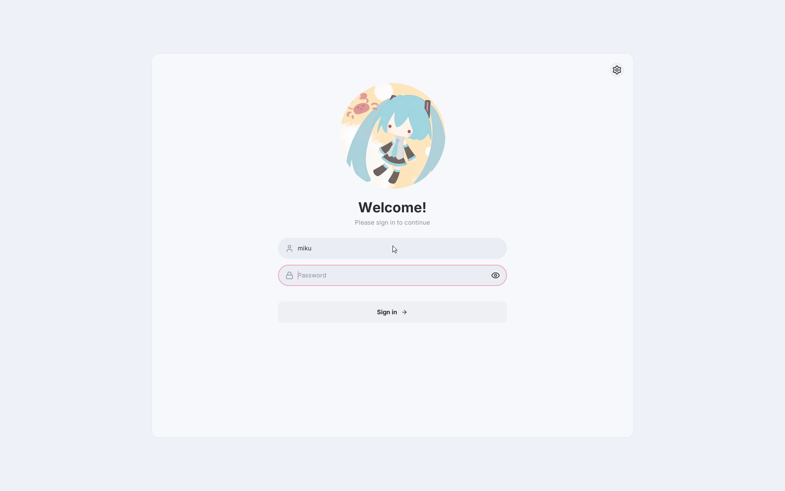
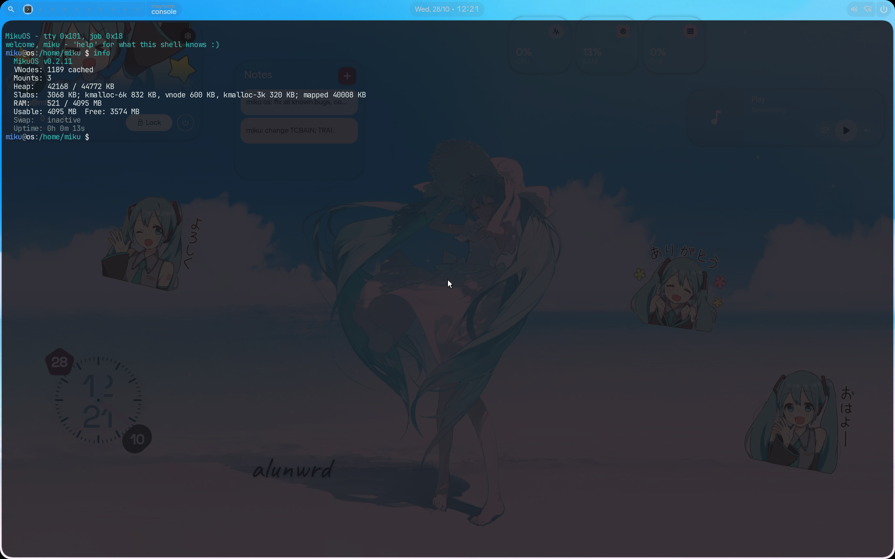
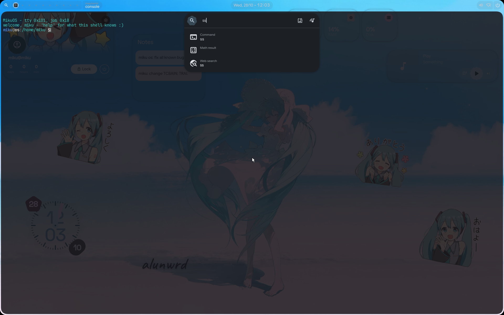

<div align="center">

# Miku OS

**Rust でゼロから書かれた x86_64 向けフルスタック OS**

*Powered by Rust and one developer*


[](https://www.rust-lang.org/)
[]()
[]()
[]()
[]()

<div align="center">

### グラフィカルログイン (`maygreet`)
<a href="screenshots/login.png">
  
</a>

<br><br>

### デスクトップ: `aosh` + `maywm`、`mayterm` の中の `msh` で `info` を実行
<a href="screenshots/desktop.png">
  
</a>

<br><br>

### `aosh` のランチャー
<a href="screenshots/launcher.png">
  
</a>

<p><em>(QEMU で撮影。QEMU ではデスクトップをプロセッサが合成します。影、角丸、枠線もそこで描かれますが、
ぼかしとフェードは RTX 5060 Ti 上の GPU のコンピュートパスによるものです。スクリーンショットをクリックするとフル解像度で表示されます。)</em></p>

</div>

</div>

---

> **翻訳:** [Русский](Russian_README.md), [English](English_README.md), [日本語](Japanese_README.md)
> **ABI リファレンス:** [MikuOS_ABI.md](MikuOS_ABI.md) · **セキュリティモデル:** [MikuOS_Security.md](MikuOS_Security.md)
> **NVIDIA:** [GB206 / RTX 5060 Ti](Nvidia_gb206.md) · [TU116 / GTX 1650](Nvidia_tu116.md)
> **リファレンス文書:** [WIKI.md](../WIKI.md) ([docs/wiki/](wiki/) の目次) · **開発ノート (設計・判断・計測):** [dev/](../dev/README.md)

---

## 概要

**Miku OS** は Rust の `no_std` 環境でゼロから作られたオペレーティングシステムです。カーネルの下には
C ライブラリもホストのランタイムもありません。メモリ配置、割り込み処理、スケジューリング、ファイルシステム、
ドライバ、ディスプレイサーバ、GPU ドライバはすべてここで書かれています。カーネルの上のプログラムは、Rust で
書かれた MikuOS 独自の C ライブラリ `libc_miku` と、その上に作られた Rust `std` を使います。

現在動いているもの:

- プロセス**とスレッド**、futex、Linux と同じ形のシグナル、vDSO を備えたプリエンプティブ SMP カーネル
- 端末: 疑似端末、セッション、プロセスグループ、ジョブ制御。シェル (`msh`) は ring 3 で動作
- tmpfs、ext2/3/4、btrfs (読み取り専用)、memfs の上の VFS。ページキャッシュ、ディスク上のファイルの
  ライトバック、inotify
- カーネル内の TCP/IP スタックと、ring 3 の DNS、TLS 1.3、HTTP
- ディスプレイサーバ兼コンポジタの **Mayland** と、その上のデスクトップ: Hyprland 風のウィンドウ
  マネージャ (`maywm`)、端末 (`mayterm`)、本物の JavaScript を使う QML で書かれたデスクトップシェル **aosh**
- RTX 5060 Ti (GB206, Blackwell) 用の独自 **NVIDIA ドライバ**: GSP-RM の起動、DisplayPort 出力、
  ビデオメモリからのスキャンアウト、デスクトップのぼかし・陰影・描画をカード上で行うコンピュートチャネル
- **Rust `std` の移植**: `std::thread`、`std::sync`、`std::net`、`tokio`、`smol` - そして **Zed エディタ**
  がその上で動作
- **独自の libc** (`libc_miku.so`、約 540 のエクスポート関数、Rust で実装) と C ヘッダ。C ライブラリ -
  SQLite、zstd、tree-sitter、FreeType - はこれに対してビルド・リンクされます
- **setuid ビットなし**のログインと権限昇格 (ブローカー経由)、Argon2id パスワード
- パッケージマネージャ (`mikupkg`) とインストーラ

> 上に挙げたベンダリングされた C ライブラリを除き、すべて Rust で書かれています。アセンブリは
> ブートエントリ、システムコールと例外のエントリ、AP トランポリン、コンテキストスイッチにのみ現れます。
> いずれも呼び出し規約が正確でなければならない場所です。

**規模:** カーネル約 182,000 行 (463 ファイル)。ライブラリ約 140,000 行 (ext と btrfs のドライバ、
libmiku、ディスプレイプロトコル、ネットワークプロトコル、パッケージマネージャ、`std` の移植)。
プログラム約 66,000 行 (`system/`、`utils/`、`aosh/`、`apps/`、`stdapps/`)。

---

## カーネル

| コンポーネント | 説明 |
|:--|:--|
| **アーキテクチャ** | x86_64、`#![no_std]`、`#![no_main]` |
| **ブート** | GRUB2 + Multiboot2、BIOS ブート (UEFI 下では GRUB 2.14 の `multiboot2` が例外を起こします)。本来のコンソールができる前から、早期コンソールが各ブート段階をフレームバッファに描きます。各ブートステップは名前を表示し、5 ms 以上かかったものはそのミリ秒も表示します。カーネル自身のブートは QEMU/KVM で約 115 ms です |
| **アドレス空間** | `0xFFFFFFFF80000000` のハイヤーハーフカーネル、`0xFFFF800000000000` の HHDM ダイレクトマップ |
| **CPU 保護** | NX、WP、SMEP、SMAP を有効化。ring 3 から入るたびに方向フラグをクリア。FPU/SSE の状態はタスクごとにあり、切り替え時に保存 |
| **割り込み** | IDT、LAPIC + IO-APIC (8259 はマスク)。NVMe (キューごとのベクタ)、AHCI、virtio-net、GPU に MSI と MSI-X |
| **タイマー** | PIT で校正した 250 Hz の LAPIC タイマー。ナノ秒単位のスリープと `poll` のタイムアウトのための CPU ごとのタイマーキュー |
| **SMP** | 最大 64 CPU。ACPI MADT、INIT/SIPI、CPU ごとの GDT/TSS/GS。TLB シュートダウンはそのアドレス空間を読み込んでいる CPU にだけ送られます |
| **スケジューリング** | CFS 風の vruntime、ヒープとして持つ CPU ごとの実行キュー、配置とワークスティーリング、`hlt` 前のアイドルポーリング、最大 32,768 タスク |
| **カーネルヒープ** | サイズクラスごとのスラブと CPU ごとのマガジン。32 KiB を超えるものは `vmap` から。メモリ逼迫時はシュリンカーが返却。`slabdebug` で全オブジェクトを検査 |
| **カーネルスタック** | ガードページ付きで `vmap` に配置: プログラムのタスクは 128 KiB、カーネルスレッドは 512 KiB |
| **システムコール** | `SYSCALL`/`SYSRET` による 124 個 (0-123、すべて割り当て済み)。`sigreturn` は `iretq` で戻ります |
| **vDSO** | システムコールなしの `clock_gettime`、`gettimeofday`、`getcpu` (`Instant::now` は 11 ns) |
| **時計** | ブート時に CMOS から。設定は `mikudo ntpdate` または `clock_settime` で行います (NTP による自動同期はありません) |
| **カーネルログ** | レベル付きのレコードをメモリに保持 (`klog`)。レベル別の 3 つのリングで、雑多なログがエラーを押し出すことはありません。`dmesg` で読み、`pstore` は選ばれた行をウォームリブートをまたいで保持 (`klogpstore` ならログ全体)。バックトレースにはシンボル名が付きます |

### ロックと待機

- **`SchedMutex` / `SchedRwLock`** (`kernel/kcore/sched_lock.rs`) はしばらくスピンしてからスリープします。
  VFS ロックとページキャッシュのロックは読み書きロックで、`stat`、`open`、`getdents`、`close`、キャッシュ
  からの読み込みは並行して動きます。ディスクリプタの読み取りはロックを一切取りません (スロットごとの
  シーケンスカウント)。
- 割り込みハンドラが触れるものには **`IrqMutex`**。タイマーハンドラはロックを一切取りません。
- タスクが待つ場所にはすべて**待ちキュー**。条件を確認してから別途スリープする待機はありません。それは
  起床の取りこぼしであり、見つかったものはどれも 100 ms の停止を起こしていました。
- **`/proc/lockstat`** (ブートラインに `lockstat`): スリープするロックごとの取得回数と競合回数、保持時間の
  分布、最長の保持とその取得場所、VFS ロック保持中に行われたディスクの読み書き。

### カーネル自身のメモリ安全性

以下はいずれも、実際に起きた診断の難しいバグを捕まえたために存在します:

- **スタックのガードページ** - オーバーフローはそれを起こした命令で例外になり、例外はタスク名を示します。
- **`slabdebug`** - 毒入れとレッドゾーン付きのオブジェクト: 末尾を越えた書き込み、二重解放、解放後の
  書き込みは、起きたその場所で報告されます。
- **`IrqMutex`** - 割り込みハンドラが取る普通のスピンロックは、CPU を自分自身とデッドロックさせます。
- **シュートダウンまで読み取り専用の copy-on-write** - 兄弟 CPU が古いエントリ経由で書き込むことはありません。

---

## メモリ管理

| 部分 | 詳細 |
|:--|:--|
| **物理** | 使用可能な最上位フレームに合わせたビットマップ。copy-on-write のカウントはフレームごとに 1 つのアトミック。ページフォルト用の CPU ごとのフレームキャッシュ |
| **仮想** | `AddressSpace` 型の背後の 4 レベルページング。カーネル側の半分はすべてのアドレス空間で共有 |
| **ページフォルト** | フォールトアラウンド付きのデマンドページング (直前のページがマップ済みなら 16 ページ)。`fork` をまたぐ copy-on-write |
| **mmap** | 匿名 (プライベートのみ)、ファイル、ファイルの `MAP_SHARED` (tmpfs ファイル自身のフレーム)、`mprotect`、`msync` |
| **スワップ** | 逆マップ、エージング付きクロック方式の追い出し、元のフラグを保つスワップ PTE。回収は **kswapd** スレッドで。スワップデバイスは最大 256 MiB のものが 1 つで、スワップアウトできるのは物理メモリの先頭 256 MiB にあるフレームだけです |
| **ページキャッシュ** | ディスク上のファイルのページ。ヒット時は VFS ロックなしで読み、bdflush、`fsync`、ダーティ上限で書き出し |

---

## プロセス、スレッド、シグナル

| 機能 | 詳細 |
|:--|:--|
| **モデル** | スレッドごとに 1 タスク。プロセスのスレッドはスレッドグループ (`tgid`) を共有し、ディスクリプタ、メモリ、資格情報はリーダーを通じて解決 |
| **生成** | `fork` (copy-on-write)、`exec`/`execve`、POSIX のステータスワードを返す `wait4`、`thread_create`/`thread_exit`、`gettid` |
| **スレッドの制限** | フラグ付きの `clone` はありません。リーダー以外のスレッドからの `exec` は拒否されます |
| **同期** | `futex` (待機、起床、タイムアウト。`MAP_SHARED` の tmpfs ページはそのフレームをキーにするので、プロセスをまたいで動作) により、`std::sync` に MikuOS 固有のコードは不要。requeue、優先度継承、ロバストリストはありません |
| **シグナル** | シグナル 1-31、Linux の `siginfo_t` と `ucontext_t` のレイアウト: ハンドラはマシン全体を受け取り、書き換えられます (wasmtime はそうします)。`SA_RESTART` は受け付けますが、動作には反映されません。CPU 例外はシグナルです - `#PF` は `SIGSEGV`、`#UD` は `SIGILL`、`#DE` は `SIGFPE`。`sigaltstack` はスレッドごと |
| **端末** | セッション、プロセスグループ、制御端末、`SIGTTIN`/`SIGTTOU`、ジョブ制御 |
| **プログラムが落ちたとき** | クラッシュレポートが例外とシンボル付きのスタックを示し、デバッガ用の ELF コアが `/tmp` に置かれます |
| **ELF ローダー** | 悪意のあるイメージに対して堅牢化。セルフテストがそれらをメモリ上で組み立てます |
| **資格情報** | uid/gid、補助グループ、ケーパビリティ (`capget`/`capset`)、カーネルオブジェクトとしてのセッション |

---

## システムコール

124 個の番号 (0-123、すべて割り当て済み)。引数とエラー付きの完全な表は [MikuOS_ABI.md](MikuOS_ABI.md) にあります。

| 番号 | 分野 |
|:--|:--|
| 0-17 | `exit`、`write`、`read`、`mmap`、`munmap`、`mprotect`、`brk`、`getpid`、`getcwd`、TLS、`open`、`close`、`seek`、`fsize`、`map_lib`、`sleep`、`uptime` |
| 18-42 | ファイル: `stat`、`fstat`、`mkdir`、`rmdir`、`unlink`、`readdir`、`rename`、`link`、`chmod`、`chown`、`dup`、`dup2`、`write_file`、`truncate`、`symlink`、`readlink`、`pipe`、`chdir`、`statfs`、`fallocate`、xattr、`utimensat`、`fsync`、`punch_hole` |
| 43-55 | `fork`、`wait4`、`kill`、`exec`、`umask`、uid/gid 系 |
| 56-59, 62-66, 77, 80, 83-85, 114 | ソケット: `socket`、`connect`、`send`、`recv`、`bind`、`listen`、`accept`、`sendto`、`recvfrom`、`socketpair`、ソケットオプション、`peercred`、`sendfd`/`recvfd` |
| 60-61, 67-71 | `mmap_file`、`msync`、`execve`、`sigentry`、`sigreturn`、`clock_gettime`、`ioctl` |
| 72-76, 78-79, 81-82 | ディスプレイのプール、`klog`、`poll`、`getrandom`、`clock_settime`、xattr の一覧と削除 |
| 86-93 | `setresuid`、`setresgid`、`setgroups`、`getgroups`、`capget`、`capset`、`session`、`power` |
| 94-98, 121 | GPU: `gpu_info`、`gpu_submit`、`gpu_bind`、`gpu_wait`、`gpu_program`、`gpu_alloc` |
| 99-105 | `tty`、`sigdisp`、`setpgid`、`getpgid`、`procinfo`、`kcmd`、`proc_path` |
| 106-120 | スレッド (`thread_create`、`thread_exit`、`gettid`、`sched_yield`、`futex`)、`getdents`、`lstat`、`fcntl`、`getsockopt`、`sigaltstack`、inotify (116-118)、`realpath`、`pipe2` |
| 122-123 | `sleep_ns`、`poll_ns` |

パス引数の長さの上位半分はディレクトリのディスクリプタを表します - `*at` 系の呼び出し、`fchmod`、
`F_GETPATH` はこれで表現されます。ディスクリプタ付きの空のパスは、そのディスクリプタ自身のファイルを指します。ユーザーポインタはすべてページ単位で検査され、パスは使用前にカーネルに
コピーされます。

---

## 仮想ファイルシステム

| 項目 | 値 |
|:--|:--|
| vnode | LRU とシュリンカー付きの動的テーブル。まとめて回収 |
| 名前 | ディレクトリエントリは独立したオブジェクト: ハードリンクの別名、inode キャッシュ、ネガティブエントリ、ホワイトアウト。inode 番号は安定 |
| プロセスあたりのオープンファイル | 512 |
| 名前の長さ | 255 バイト |
| tmpfs | フレームで、RAM の 4 分の 1 まで。ファイルは 4 GiB まで |
| ファイルシステムの種類 | tmpfs、devfs、procfs、ext2、ext3、ext4、btrfs (読み取り専用)、memfs |

- **ファイルシステムは 1 つのトレイト** (`FileSystem`) と 1 つのレジストリの背後にあり、VFS のどこにも
  フォーマット名は出てきません。
- **ロックなしの名前解決**: キャッシュにない名前は VFS ロックを手放してディスクから読み、その間に
  ディレクトリが変わっていなければ登録します。
- **ディスク上のファイルのページキャッシュ**: キャッシュからの読み込みは VFS ロックを取りません。書き込みは
  ダーティページとしてそこに入り、`fsync`、bdflush (5 秒より古いページ)、ダーティ上限を超えた書き込み側に
  よって書き出されます。大きなファイルのブロックとページはロックの下ではなく、ロックの後に解放されます。
- Linux の ABI による **inotify**。パイプは匿名 vnode。POSIX レコードロック (`fcntl`)。
- `/proc` には 12 のファイルがあります: `version`、`uptime`、`meminfo`、`mounts`、`cpuinfo`、`stat`、`heap`、
  `diskstats`、`net`、`clock`、`slabinfo`、`lockstat`。プロセスごとのディレクトリはありません。

---

## ファイルシステム

### ext2 / ext3 / ext4 (`lib/fs/extfs`、`kernel/fs/ext/` でマウント)

ドライバは独立したクレートで、ディスク上のフォーマットを知っていても、このカーネルのことは何も知りません。
ディスクには 1 つのトレイト (`lib/fs/fshost` の `BlockHost`) を通じて到達します。狙いはテストのループです -
`cd lib/fs/extfs && cargo test` はメモリ上にファイルシステムを作り、わざと壊し、トランザクションの途中で電源を
切り、ドライバの動作を確認します。ブート 1 回分ではなく数秒で。

| 機能 | 詳細 |
|:--|:--|
| **読み込み** | 直接、間接、二重・三重間接ブロック、ext4 のエクステントツリー、インラインデータ |
| **書き込み** | エクステントは連続範囲でまとめて確保・解放。ファイルのデータはデバイスに直接書かれ、新しいブロックのデータはそれを指すエクステントより先に書かれます。開いているトランザクションが解放したブロックは、コミットまで再利用しません |
| **ディレクトリ** | ハッシュインデックス (`dir_index`) の読み書き: 成長時にインデックスを構築し、リーフはハッシュの境界で分割され、ツリーは段を増やします |
| **ext3 ジャーナル** | JBD2: ハンドル付きトランザクション、ディスクリプタとリボークブロック、ピン留めによるライトアヘッド順序、マウント時のリプレイ、オーファンリスト、ログ全体の crc32c |
| **ext4** | 任意の深さのエクステントツリー、`fallocate` 用の未書き込みエクステント、`64bit` 機能 (内部のブロック番号はまだ 32 ビット)、flex_bg、ナノ秒と 2038 年以降のタイムスタンプ |
| **チェックサム** | すべてのメタデータ構造に crc32c (使えれば SSE4.2) |
| **整合性** | 5 パスの検査と修復 (`extfsck`)、オーファンの後始末、TRIM、`fiemap` |
| **mkfs** | ext2/ext3/ext4、`metadata_csum` 付きの ext4 |

検証は自分自身ではなく e2fsprogs と照らし合わせて行います: テストが作るすべてのイメージに
`e2fsck -f -n`、`mke2fs` のイメージから取ったチェックサムの再現、`e2fsck -D` が作ったディレクトリ
インデックスへの書き込みと `debugfs` による走査、そして操作のすべての書き込みで電源を切り、得られた
各イメージを `e2fsck` に渡します。

### btrfs (`lib/fs/btrfs`)

カーネルでは読み取り専用: チャンクツリー、ファイルシステムツリー、エクステント、インラインファイル。
クレートには copy-on-write トランザクション、アロケータ、コミットもあり、ビルドホストで `mkfs.btrfs` の
イメージを使ってテストされています。

### その他

- **tmpfs** - ルートファイルシステム。**memfs** - 媒体を持たないマウント可能なファイルシステムで、VFS を
  2 つ目のフォーマットに対してテストするのに使います。**devfs**、**procfs**
- **GPT** - パーティションテーブルの解析、パーティションノード、`partprobe`
- **インストーラ** - コンソールの `install plan` / `install go`、または同じ質問をするウィンドウ

---

## ストレージスタック

```
VFS → ページキャッシュ → ファイルシステム → ブロック層 (キャッシュ、bdflush) → ドライバ → デバイス
```

- **ブロック層** (`kernel/io/block/`): デバイスレジストリ、パーティション、デバイスごとの統計、discard と
  write-zeroes、健全性 (NVMe のログページ、ATA SMART)、`/proc/diskstats`
- **ドライバ** (`kernel/drivers/block/`): `nvme` (CPU ごとの I/O キュー、キューごとの MSI-X ベクタ)、
  `ahci` (MSI)、`ata` (PIO + バスマスタ DMA)、`virtio_blk`、`ramdisk` (GRUB が渡すファームウェアイメージ)。
  待つ側は 50 µs ポーリングしてからスリープします。

---

## ネットワークスタック

| 層 | 対応 |
|:--|:--|
| **ドライバ** | Intel e1000 ファミリー、Realtek RTL8139 と RTL8111/8168 (PCI ID 8169 は RTL8139 ドライバに渡されます)、MSI-X 対応の virtio-net (トランジショナル ID 1af4:1000) |
| **リンク / ネットワーク** | Ethernet、ARP、IPv4、ICMP |
| **トランスポート** | UDP。再送とリスナーを持つ TCP (`TIME_WAIT` と `CLOSING` の状態はまだありません)。RFC 6056 によるポート選択 |
| **ring 3** (`lib/net`) | DNS (`getaddrinfo`)、HTTP/1.1、HTTP/2、NTP、`/etc/ssl/certs/ca-bundle.pem` のルートに対して証明書を検証する TLS 1.2/1.3 クライアント - トラストストアがなければ接続しません |
| **ソケット** | AF_INET (TCP、UDP、raw ICMP)、`peercred` とディスクリプタ受け渡しを備えた AF_UNIX、AF_MAYLAND |

`netd` がブート時に DHCP を行います。`ping`、`traceroute`、`wget`、`curl`、`host`、`ntpdate` は `/bin` のプログラムです。
ループバックインターフェースはなく、`shutdown`、`getsockname`、`getpeername` はまだ実装されていません。
完全なリファレンスは [docs/wiki/network.md](wiki/network.md) にあります。

---

## グラフィックス: Mayland、デスクトップ、GPU

### Mayland (`kernel/mayland/`、`lib/gfx/mayland/`)

ディスプレイサーバ兼コンポジタ。プロトコルは Wayland のワイヤーフォーマットを独自のソケットファミリー上で
使います。共有メモリはカーネルのハンドル、キーマップはテーブルです。プロトコルとフォントラスタライザの
1 つのコピーが、サーバとすべてのクライアントの両方に組み込まれます (`libmay`)。

- **合成**: ダメージ追跡、角を丸めたスクワークル形のウィンドウ、枠線、影とぼかし、カーブによる
  アニメーション、閉じるウィンドウの残像、ウィンドウの上下のレイヤー、ポップアップ、クリップボード、
  ハードウェアカーソルプレーン。
- **ウィンドウ管理**はプログラムです: **`maywm`** は Hyprland 風の設定 (`/etc/mayland/default.d/*.conf`、次に `may.conf`、次に
  `conf.d/*.conf`。後の行が優先) を読みます: タイリング、
  ワークスペース、ルール、バインド、`exec-once`、モニター。誰も認識しなかった行は捨てられず、報告されます。
- **出力**: モニターの EDID からのモード。デスクトップは 1 つの出力上で合成されます (2 つ目のヘッドは
  書かれていますが、まだ動かしていません)。ドライバの上のディスプレイ層 (`kms`) はテスト先行の
  アトミックなリクエストを受け付け、`maywm` の `monitor =` 行は Hyprland のものと同じです。
- **クライアント**: `mayterm` (自分の pty でシェルを動かすウィンドウ)、`maygreet` (ログイン画面)、
  `maysession`、インストーラ、`maydemo`、Zed。

### aosh - デスクトップシェル (`aosh/`、`etc/aosh/`)

aosh は MikuOS にとって、Hyprland にとっての quickshell にあたります: QML ファイルのディレクトリを読み、
そこからバー、ランチャー、オーバービュー、ポップアップを描く 1 つのプログラムです。言語は QML のサブセットで、
すべての式と関数は本物の JavaScript (QuickJS) です。テキストは FreeType と rustybuzz で描かれ、
Qt のグリフとピクセル単位で一致します。矩形、グリフ、Canvas、エフェクトは Qt Quick と同じように描かれ
(Qt との差は 1-2/255 以内)、カードではコンピュートプログラムで、それ以外ではプロセッサで描かれます。
実際の quickshell 設定の移植 (`etc/aosh/negi`、`aosh -c negi` で起動) が同梱されています。自分の設定は
`~/.config/aosh` に置きます。`/etc` は読み取り専用のブートイメージだからです。
[docs/wiki/aosh.md](wiki/aosh.md) と [docs/wiki/mayland.md](wiki/mayland.md) を参照してください。

### カード上で

RTX 5060 Ti ではコンポジタが GPU のコンピュートエンジンで動きます: ぼかし、影、角の丸め、ウィンドウの合成は
GPU プログラムで、すべてのウィンドウはビデオメモリに保持され (コピーエンジンがそこへコピーします。
`notex` で無効化)、aosh 自身の描画も GPU プログラムです。コンピュートパスが扱えないサーフェスは
プロセッサがブレンドします。それがドライバの仕事で、以下で説明します。

---

## NVIDIA GPU ドライバ (`kernel/drivers/gpu/nvidia/`)

**GeForce RTX 5060 / 5060 Ti (GB206、Blackwell)** 用の独自ドライバで、130 ファイル約 52,000 行。公開されて
いる `nvidia-open` のソース (OpenRM) を関数ごとに読んで書かれています。移植ではありません: C も Linux の
互換層もありません。カードの GSP-RM ファームウェアを起動し、OpenRM と同じ方法でそれと通信し、その上の
表示、メモリ、コンピュートの経路はこのカーネル独自のものです。設計ノートは [`dev/`](../dev/README.md)
(`gsp-foundation.md`、`gsp-615.md`、`gb206-display.md`、`gpu-memory-compute.md`、`kms-architecture.md`、
`gpu-perf.md`)、ユーザー向けのノートは [Nvidia_gb206.md](Nvidia_gb206.md) にあります。

### 起動

```
PCI プローブ → BAR0/BAR1 → FSP のチェーンオブトラスト (EMEM 上の MCTP) → GSP-FMC → GSP-RM 615 が稼働
             → RPC トランスポート確立 → system info、registry、static info → RM オブジェクトツリー → エンジン
```

- **FSP ブート** (`blackwell/fsp.rs`、`fmc.rs`、`gspboot.rs`): Blackwell ではホストが falcon を自分で
  動かすことはありません。GSP-FMC と GSP-RM のイメージをシステムメモリに置き、FSP にチェーンオブトラストの
  メッセージを 1 つ送ります。FSP が FMC を検証し、FMC が保護領域を確保して GSP-RM を起動します。
- **単一のファームウェアリリース**: ドライバは GSP-RM **615.78.08** と通信します - OpenRM と同じく、
  ファームウェアとそれと話すコードは同じリリースのものです。GSP-RM と ucode は NVIDIA のドライバパッケージ
  から抽出され、FMC とブートローダは OpenRM 615.78.08 の bindata から作られます (`dev/nvidia/fw_extract.py`
  に `--tree refsrc/openrm`)。それらすべてを ext2 イメージにまとめ、GRUB モジュールとして渡します。

### GSP-RM との通信 (`gsp_common/`)

- **トランスポート** (`rpc/`): 615 のメッセージキュー (MCTP/NVDM フレーミングの MSGQ 2.0)、OpenRM の
  ブート時許可リストを持つ単一の受信経路、ヘッダの検査 (MCTP のバージョン、ベンダー、マジック、サイズ)、
  関数とシーケンスによる応答の照合、すべての呼び出し前の健全性確認。
- **ライフサイクル** (`kgsp/`): アトミックにしか触れない割り込みハンドラと、下半分としてのワーカースレッド。
  イベント、ヘルスチェック、**マシンを再起動しないアンロードと再ロード**、CrashCat レポート。
- **RM API** (`rmapi.rs`): すべてのオブジェクトは本物の親を持つ RM クライアント経由で確保されます -
  クライアント、デバイス、サブデバイス、メモリ、チャネル、ディスプレイ - GSP-RM が期待するツリーです。
- **ログ**: GSP-RM 自身のログをデコードします (`logdecode.rs`)。すべての RPC と RM 呼び出しはステータス
  付きで debug レベルでカーネルログに、robust-channel エラー、Xid、CrashCat は error レベルで記録されます
  (`nvidia log`)。

### メモリ

- **独自の GPU MMU** (`gmmu.rs`、`vaspace.rs`): ページテーブルはここで構築され、4K、64K、2M のページと
  TLB 無効化に対応。プロセッサからビデオメモリへの書き込みのために BAR1 をマップします。
- **ビデオメモリのアロケータ** (`gsp_common/vram.rs`) と**プログラムがマップできるプール** (`gpu_alloc`):
  バッファがビデオメモリにあるウィンドウは、コンポジタがその場で読みます - MikuOS の DMA-BUF です。

### チャネル、コピー、コンピュート

- プッシュバッファとセマフォを持つ GPFIFO チャネル。アップロードとウィンドウのコピーのための **copy
  engine**。QMD (`qmd.rs`) でプログラムを起動する**コンピュートチャネル**で、1 回の投入で複数を起動します。
- **GPU プログラム**は CUDA C で書かれ (`shaders/*.cu`: blur、composite、fill、over、paint)、ビルド時に
  `nvcc` でコンパイルされ、MikuOS 独自の cubin パーサ (`cubin.rs`) で読まれます - 同じパーサがビルド時に
  検査し、カーネルでロードします。
- **ユーザープログラム**: `gpu_program` (98) はプロセスが渡したプログラムを `CAP_GPU` のもとでロードします。
  `gpu_submit`、`gpu_bind`、`gpu_wait`、`gpu_info` がインターフェースを補います (`apps/gpudemo`)。

### 表示 (`blackwell/display.rs`、`gsp_common/modeset/`、`kernel/drivers/gpu/kms/`)

- **DisplayPort** のリンクトレーニング、**HDMI**、IMP (ディスプレイの帯域とクロックの検査)、ヘッドと
  ウィンドウ、ビデオメモリからのスキャンアウト、モニターの EDID からのモード。
- **カラーパイプライン**: 入力 LUT、色空間変換、出力 LUT、ディザとクランプを、ハードウェアの順序で。入力 LUT
  は half-float です - 16 ビット固定小数点で書いていた間、画面は何週間も真っ黒でした。
- デフォルトで**カーソルプレーン**、フリップセマフォ付きのウィンドウのフリップ。**2 つ目のヘッド**と VRR は
  書かれていますが、まだパネルで動かしていません。
- **KMS** (`kms/`): DRM のオブジェクトとテスト専用のアトミックなリクエストを持つ、ドライバの上の層。出力は
  nvidia-drm と同じ名前 (`DP-1`、`HDMI-A-1`) なので、Hyprland の `monitor =` 行がそのまま使えます
  (QEMU で検証済み。カードではまだ動かしていません)。

### 電源とクロック (`gsp_common/perf/`)

クロックを変えるのはファームウェアです。ドライバはファームウェアが報告するもの - GSP-RM が書き込むページ
からのクロック、負荷、電力、温度と PMU の履歴 - を読み、OpenRM のクライアント OS と同じ方法でブースト、
クロック固定、下限を要求します。

### 診断と非常口

- `run=nvidia_selftest` - 184 ケース、画面なし。`run=` で無人の **GSP アンロード/再ロードテスト**も
  実行でき、そのログはウォームリブートをまたいで残ります (`pstore`)。
- カーネルシェル: `nvidia` (`gb206`、`log`、`perf`、`rm-tree`、`gsp unload` / `gsp load` / `gsp reset`、
  `selftest`)、`display`、`mayland status`。すべてのサブコマンドは
  [Nvidia_gb206.md](Nvidia_gb206.md#commands) にあります。
- GRUB フラグ: `nogpu` (カードに触れない)、`nointr` (GPU の待機をすべてポーリング)、`nononstall` (フェンスを
  ポーリング)、`nobar1` (PRAMIN 経由の書き込み)、`gpu4k` (4K ページのみ)、`notex` (ウィンドウをシステム
  メモリから読む)、`nohwcursor` (ソフトウェアカーソル)、`noflipsema`、`nobackdrop` (背景のぼかしなし)、そしてブート順序の非常口
  `gspbase`、`pciebase`、`coldhead`、`edidbase`。完全な表は
  [Nvidia_gb206.md](Nvidia_gb206.md#boot-flags) にあります。

### Turing

**TU116 / GTX 1650** の経路 (`turing/`) はホスト側の立ち上げを行い、ブート時に GSP-RM のイメージを用意します。
6 段階の完全な GSP-RM ブート (FWSEC、WPR2、SEC2、booter) は要求したときだけ実行され (`nvidia gsp-rm-boot-full`)、
まだ最後まで進むことは期待されていません。Turing のカードで実行されたことは一度もありません。TU117 はホスト側の
立ち上げのみです。表示とコンピュートはありません ([Nvidia_tu116.md](Nvidia_tu116.md))。

---

## 入力と端末

- **キーボード** - PS/2 と USB HID (xHCI、HID レポートパーサ)。独自のキーボードレイアウト。キーリピートは
  ハードウェアのタイプマティックから (PS/2 のみ: USB キーボードでキーを押し続けてもまだリピートしません)。
- **マウス** - PS/2 と USB。
- **端末** (`kernel/io/tty/`) - マスターがディスクリプタである pty テーブル (`/dev/ptmx`、`/dev/ptsN`)、
  端末ごとの `termios` (カノニカルと raw モード、エコー、シグナル文字)、ウィンドウサイズ、`/dev/tty`、ハングアップ。
  端末は全部で 8 つ: コンソールと 7 つの pty。
  [docs/wiki/input-and-terminals.md](wiki/input-and-terminals.md) を参照してください。
- **コンソール** - フレームバッファを読み返さないテキストコンソール。シリアルポートにもミラーされます。
  デスクトップが起動するとカーネルのコンソールはシリアルのみになりますが、パニックは画面に描かれます。

---

## mikuD - init デーモン

PID 1: 32 個のサービスの固定テーブルを持つカーネルスレッドです。それらのライフサイクル、依存関係、再起動を担います。

| 概念 | 値 |
|:--|:--|
| **ターゲット** | `SysInit`、`MultiUser`、`Graphical`、`Rescue` |
| **再起動ポリシー** | `Always`、`Never`、`OnFailure`、`OnSuccess`、`OnAbnormal` |
| **サービスのエントリ** | カーネルの `fn()` または ELF プログラムのパス (デフォルトのブートでは `/bin` は読み取り専用の GRUB モジュール) |
| **その他** | 依存グラフ、順序付け、再起動の遅延、マスク、ジャーナル、`.service` ユニットファイル、サービスの最初の命令より前に適用される `User=` と `Capabilities=`。ウォッチドッグと `Type=notify`: サービスは `mikuctl notify --ready`/`--watchdog` で状態を報告します。`*Sec` の時間は秒単位です (`ms`、`s`、`min` の接尾辞も使えます)。タイマーユニットとソケットアクティベーションはコードにはありますが、まだそれらを動かすものがありません |

ブート時に起動するサービス: `kbd`、`usbd` (`nousb` のときは除く)、`netd`、`bdflush`、`kswapd`、`mikudod`、
`shell`、そしてグラフィカルターゲットでは `compositor` と `greeter`。完全なリファレンスは
[docs/wiki/system.md](wiki/system.md) にあります。

---

## ユーザー空間

### Rust `std` (`lib/sdk/rust-std/`)

`target_os = "miku"` 向けの `std`: プラットフォーム層はシステムコールではなく `libmiku` を呼ぶので、
番号を知っているのは 1 つのライブラリだけです。`fs`、`path`、`env`、`io`、`process`、`net`、`time`
(vDSO 経由)、`thread`、`sync` (futex の上)、`thread_local` が動作し、`tokio`、`smol`、`polling` は `poll`
の上で動きます。`target_family = "unix"` を宣言しているので、`unix` で分岐するクレートもビルドできます。
`stdapps/` のプログラムはテストスイート (`stdfs`、`stdthreads`、`stdtokio`、`stdpty`、`stdwatch`、
`stdsignal` など) と、Linux 向けにもビルドして比較できる `stdbench` です。まだないもの: IPv6、`File::lock`、
ソケットのタイムアウト、`shutdown`、`local_addr`/`peer_addr`、ポート 0 への bind。

**Zed** エディタは、いくつかのパッチと Mayland を話す 4 つ目の gpui バックエンドを加えて、自身のソースから
MikuOS 向けにビルドされます。イメージにパッケージとして含まれ、デスクトップから起動します。

### libc と C (`lib/runtime/libmiku/`、`lib/sdk/c/`)

**`libc_miku.so`** は Rust で書かれた MikuOS の C ライブラリで、約 540 の関数をエクスポートします
(10 個の `miku` ライブラリ全体では約 1450)。
`stdio` (`printf`/`scanf` 系、`FILE`)、`string`、`stdlib`、`ctype`、`math`、ビン方式のヒープ上の `malloc`、
`time`/`ctime`、`dirent`、`poll` と `select`、ソケットと `getaddrinfo`、`termios` と pty (`openpty`、
`posix_openpt`、`login_tty`)、`getgrouplist` を含む `pwd`/`grp`、`*at` 系の呼び出し、`setjmp`/`longjmp`、
`getauxval`、そして POSIX スレッド - `pthread_create`、ミューテックス (プロセス間共有も)、クロック指定付きの
条件変数、rwlock、`pthread_once`、キー、`pthread_atfork` - を扱います。まだないもの: `dlopen`、`posix_spawn`、
`epoll`、`eventfd`、`signalfd`、`timerfd`、ロケール。`getaddrinfo` は IPv4 のみで、`localtime` は UTC です。

`lib/sdk/c/include/` にはそのための C ヘッダが 47 個あり、`stdio.h` から `sys/socket.h`、`pthread.h` まで
揃っています。これはライブラリの C の顔であって 2 つ目の libc ではありません: ヘッダはライブラリが定義する
ものだけを宣言するので、MikuOS にないものを使う C プログラムはコンパイルで失敗し、すべての構造体の
レイアウトは `_Static_assert` で Rust の `libc` オーバーレイに固定され、ヘッダが変わるたびに検査されます。`lib/sdk/c/miku-cc`
はターゲットのフラグでホストの clang をラップします。SQLite、zstd、tree-sitter、FreeType はこの方法で
ビルドされ、`cc` で C をコンパイルする Rust クレートも同じラッパーを使います。

### 動的リンク

`ld-miku` は動的ローダーです: リロケーション、`DT_NEEDED`、プログラム自身の TLS (`PT_TLS`。TLS を持つ
ライブラリはまだロードできません)、完全な auxv、そしてどのコンストラクタよりも先に libmiku へ auxv を渡します。
`dlopen` はなく、検索パスは固定です (`/lib`、`/usr/lib`、`/usr/local/lib`)。`miku` ライブラリは `/lib` にあらかじめ読み込まれ、プロセス間で共有されます:
`core_miku`、`sys_miku`、`text_miku`、`ds_miku`、`algo_miku`、`codec_miku`、`fs_miku`、`net_miku`、
`parse_miku`、`libc_miku`。ring 3 のヒープはスレッドごとのキャッシュ付きの分離ビンを使います。

### ユーザーと権限

MikuOS はログイン画面で起動します。画面があればグラフィカルなもの、なければあなたが誰かを尋ねるコンソール -
同じログインを、同じブローカーを通じて、テキストで描いたものです。

**このシステムには setuid ビットも setgid ビットもファイルケーパビリティもありません。** `exec` はファイルの
モードビットを読みますがローダーはそれを無視するので、権限は特権プロセスが子に与えるもので、ファイルから
得ることは決してありません。これにより、`sudo`、`doas`、`pkexec` が 30 年間抱えてきたバグの種類そのものが
なくなります。[MikuOS_Security.md](MikuOS_Security.md) がそのアドバイザリを挙げています。

権限昇格はブローカーです: `/bin/mikudo` はあなたとして、何の権限も持たずに動き、mikuD が起動した
`/bin/mikudod` にローカルソケットで依頼します。呼び出し元はカーネルが `peercred` で示します。ログイン画面も
同じブローカーのクライアントです: `login` と `maygreet` は特権のない `greeter` アカウントで動き、
`/etc/shadow` を読んで Argon2id を計算するのは `mikudod` だけです。

```
login: miku
password for miku:

Welcome, miku.
miku@os:/ $ id
uid=1000(miku) gid=1000(miku) groups=1000(miku),10(wheel),100(users)
miku@os:/ $ cat /etc/shadow
  /etc/shadow: permission denied
miku@os:/ $ mikudo id
[mikudo] password for miku:
uid=0(root) gid=0(root) groups=0(root)
```

セッションはカーネルオブジェクトです: アイデンティティ、シート、それを率いるプロセス。セッションは
1 つのケーパビリティ `CAP_MAY_PRIV` を持ち、それはシートに従います: 誰もログインしていない間は greeter が
持ち、誰かがログインした瞬間にカーネルが取り上げます。greeter が表示されている間、コンポジタはフォーカスを
それに固定し、ウィンドウマネージャのキー操作はすべて無効になります。ホームディレクトリは
グラフィカルセッションが初めて始まるときに `/etc/skel` から作られます。

プログラム: `mikudo`、`mikudod`、`login`、`maygreet`、`maysession`、`passwd`、`id`、`su`、`useradd`。
ハッシュとすべてのパーサは `lib/admin/mikuauth` にあり、`cargo test` は RFC 9106 の Argon2id タグを含む約 100 ケースを
実行します。

### パッケージ (`lib/admin/mikupkg`、`/bin/mikupkg`)

コンテナフォーマット、リゾルバ、そして前に進めるのではなく必ずロールバックするジャーナル付きのトランザクション。
アプライヤが外界と接するのは `Root` トレイトだけなので、ビルダーは `/bin/mikupkg` がマシン上で使うのと同じ
コードでイメージにパッケージをインストールします。パッケージは署名されています (ECDSA P-256)。取得元の
リポジトリはまだなく、インストール済みのシステムを変更するには書き込み可能なルート (`rootrw`) が必要です。

### シェル

- **`msh`** - pty 上で ring 3 に動くシェル: クォート、パイプ、リダイレクト (`2>` も)、`;`、`&&`、`||`、
  バックグラウンドジョブとジョブ制御、行編集。変数、グロブ、制御構文はありません。`/bin` に見つからない名前は
  カーネルコンソールに回されます (`kcmd`)。[docs/wiki/msh.md](wiki/msh.md) を参照してください。
- **カーネル内シェル** - 緊急用コンソール。システムコールのないカーネル内部に届くコマンドが残っています:
  ext のツール (`extfsck`、`extinfo` など)、`mount`、`gpt`、`mkfs.ext*`、スワップ、`smart`、`fstrim`、
  サービス用の `sv`、`nvidia` と `mayland` のサブコマンド、`install`、セルフテスト。出力は fd 1 ではなく
  端末に出るので、`>` では取り込めません。すべてのコマンドは [docs/wiki/commands.md](wiki/commands.md) に
  あります。

---

## テストと診断

- **カーネル内のセルフテスト**: ブートラインから画面なしで実行します: `run=vfs_test;ext_test;poweroff`。
  メモリ、IPC、VFS、ext、btrfs、端末、ELF ローダー、資格情報、ネットワーク、カーネルログ、Mayland、
  NVIDIA ドライバのスイートと、`std` のプログラム。出力はシリアルポートへ。
  [docs/wiki/testing.md](wiki/testing.md) を参照してください。
- **ホスト上のテスト** (ブート不要): `lib/fs/extfs`、`lib/fs/btrfs`、`lib/net` (X.509、すべてのパーサ)、`lib/crypto`、`lib/base`、
  `lib/admin/mikuauth`、`lib/gfx/mayland` (`cargo test-host`)、カーネルヒープ (`kernel/mm/heap/hosttest`)、
  libmiku のヒープ (`lib/runtime/libmiku/hosttest`)、`lib/admin/mikupkg`、`lib/fs/fshost`、`lib/gfx/freetype`、`aosh`
  (`cargo test-host`)、`builder`。
- **`stdbench`** - MikuOS と Linux で同じベンチマーク。4 vCPU の QEMU/KVM と、ベアメタルの Linux の比較:
  プロセスの起動と待機 0.27 ms (Linux 0.63)、`Instant::now` 11 ns (20)、プロセス間のパイプ往復 2.1 µs (6.8)、
  `read_dir` 1 名前あたり 145 ns (130-142)、4 スレッドで `stat` 毎秒 470 万回。
- **GRUB ラインの非常口** - `noauth` (ログインなしの root コンソール)、`nosmap`/`nosmep`、`nointr`
  (GPU の待機をポーリングに)、`nogpu`、`writethrough` (ライトバックなし)、`vfsmutex` (読み取り側の VFS ロック
  なし)、`nopagecache`、`nvmepoll`、`netpoll`、`lockstat`、`slabdebug`、`trace`。完全な一覧は
  [docs/wiki/boot.md](wiki/boot.md) にあります。

---

## ビルドと実行

### 必要なもの

| ツール | 用途 |
|:--|:--|
| Rust nightly + `rust-src` | ベアメタルとユーザー空間ターゲットのための `build-std` |
| clang | `lib/sdk/c/miku-cc` 経由の C ライブラリ。aosh が必要とするので、ビルドにも必要です |
| LLVM (`llvm-ar`) | C ライブラリのアーカイブ |
| `nm` (binutils) | C ヘッダが宣言するすべての関数が定義されているかをビルダーが検査します |
| CUDA toolkit (任意) | `nvcc` が GPU プログラム (`sm_120`) をコンパイル。なくてもカーネルはビルドされ、プログラムがないことを報告します |
| `grub-mkrescue`、`xorriso`、`mtools` | ISO の作成。GRUB の `i386-pc` ファイルはシステム内のインストーラでも使われます |
| `qemu-system-x86_64` | 実行 |
| `e2fsprogs` (`mke2fs`、`debugfs`) | ルートイメージとファームウェアの準備 |

### すべてをビルド

```bash
cd builder
cargo run --release
```

ビルダーは `ld-miku`、vDSO、ライブラリ、ユーザー空間のプログラム (`system`、`utils`、`apps`、`stdapps`、
`aosh`) をビルドし、パッケージとしてルートイメージにインストールし、カーネルをビルドし、ファームウェア
イメージをまとめて `miku-os/miku-os.iso` を作成します。質問にはそれぞれタイムアウトがあります: 省メモリモード、
`stdapps` の `std` プログラムをビルドするかどうか (cargo がキャッシュから消したクレートのソースは再びダウンロード
されます。aosh はどちらでもビルドされます)、`miku-os/disk.img` のサイズ (作成または更新します)、データイメージ、
QEMU を起動するかどうか。`MIKU_FW=` はファームウェアイメージを 1 枚のカードのファイルに限定します。Zed は
別にビルドします: `builder/` で `cargo run --release -- zed build -p zed`。`cargo run --release -- std <crate>`
は任意の `std` クレートを 1 つビルドします。ビルド全体は [docs/wiki/building.md](wiki/building.md) で説明しています。

### 実行

```bash
qemu-system-x86_64 -enable-kvm -cpu host -smp 4 -m 4G \
  -boot d -cdrom miku-os/miku-os.iso \
  -serial stdio \
  -netdev user,id=n0 -device virtio-net-pci,netdev=n0
```

ディスクを使うには `-drive file=<イメージ>,format=raw,if=virtio` を追加します。ディスクがルートとしてマウント
されるのはブートラインに `root=` があるときだけで、書き込まれるのは `rootrw` があるときだけです。GRUB メニューの項目は 1 つです。
`noauth`、`nointr`、`nogpu` などのフラグは、メニューで `e` を押してそのブートにだけ追加します。すべての
フラグは [docs/wiki/boot.md](wiki/boot.md) に載っています。

### USB メモリへの書き込み

```bash
sudo dd if=miku-os/miku-os.iso of=/dev/sdX bs=4M status=progress conv=fdatasync
```

UEFI 下では GRUB の `multiboot2` が例外を起こすため、レガシー BIOS (CSM) モードでブートしてください。
カーネルが表示する値を `MIKU_FW=` に設定してビルドすると、そのカードのファームウェアだけが残ります:
`nvidia/gb206` なら ISO は 143 MB から 114 MB になります。

---

## リポジトリ構成

```
kernel/                 カーネルのソース
  arch/x86_64/          ブートエントリ、早期コンソール、GDT、IDT、例外、FPU、APIC、ACPI、SMP、RTC、per-CPU
  mm/                   フレーム、ページング、ヒープ (スラブ)、vmap、mmap、スワップ、TLB、カーネルスタック、シュリンカー
  sched/                スケジューラ、実行キュー、待ちキュー、タイマー、futex、アイドル、ワーカー
  process/              プロセス、スレッド、ELF ローダー、動的リンク、シグナル、資格情報、
                        セッション、vDSO、クラッシュレポートとコア
  syscall/              ディスパッチ、アダプタ、usercopy、errno
  fs/                   VFS、ページキャッシュ、ext、btrfs、tmpfs、memfs、devfs、procfs、GPT
  io/                   ブロック層、コンソール、フレームバッファ、入力、端末
  net/                  Ethernet から TCP まで
  drivers/              ブロック、バス (PCI、MSI)、ネットワーク、入力 (PS/2、USB)、gpu (NVIDIA、Bochs、KMS、EDID)
  mayland/              ディスプレイサーバ: プロトコル、描画、サーバ、デスクトップのポリシー、コンポジタ、入力
  mikud/                init デーモン
  setup/                インストーラのウィンドウ
  shell/                カーネル内 (緊急用) シェル
  kcore/                ブート状態、時計、ロック、カーネルログ、pstore、バックトレース、電源、RNG
lib/                    ライブラリ。地図は lib/README.md
  abi/                  miku-abi: カーネルとプログラムが共有するすべての数値とレイアウト
  base/, crypto/        純粋なアルゴリズム、暗号
  runtime/              ld-miku、vDSO、10 個の *_miku.so
  sdk/                  プログラムのビルド対象: miku クレート、C ヘッダとコンパイララッパー、
                        std の移植、libc のオーバーレイ
  fs/                   extfs、btrfs: ファイルシステムのフォーマット。fshost: ディスクに届くためのトレイト
  net/                  mikunet: DNS、TLS、HTTP - ring 3 のプロトコル
  gfx/                  mayland: libmay、両側でリンクされるディスプレイプロトコル。FreeType
  admin/                mikuauth: パスワードハッシュとアカウントファイル。mikupkg: ライブラリとしての
                        パッケージマネージャ
  buildgen/             ビルドスクリプトの共通コード: ライブラリ一覧、スタブ、shim、宣言、ジェネレータ
system/                 msh、mayterm、maywm、maygreet、maysession、mikudo、mikudod、login、
                        passwd、id、su、useradd、mikupkg
utils/                  日常のコマンド: ls、cat、cp、grep、ps、kill、mikuctl など (35 個)
aosh/                   QML のデスクトップシェル
apps/                   サンプルと ABI テスト: hello、maydemo、gpudemo、curl、wget、ping など
stdapps/                std のテストプログラムと stdbench
etc/                    イメージ内の設定: アカウント、mayland、aosh、証明書
builder/                ビルドの統括と ISO/ディスクの準備
docs/                   wiki のページ (docs/wiki/)、翻訳、ABI リファレンス、セキュリティモデル、GPU のメモ
dev/                    開発ノート: 各サブシステムの設計、判断、計測
```

---

## 作者

<div align="center">


### **alunwrd**

[](https://github.com/alunwrd)

*Rust で、ゼロから、一人で書かれました。*

</div>

## ライセンス

Apache 2.0 - [LICENSE](../LICENSE) を参照してください。
