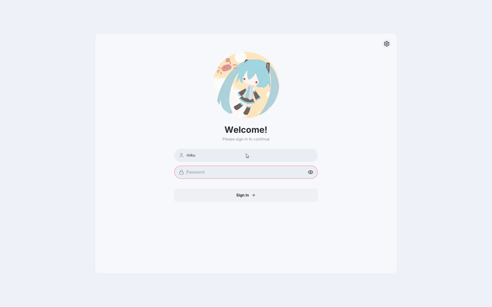
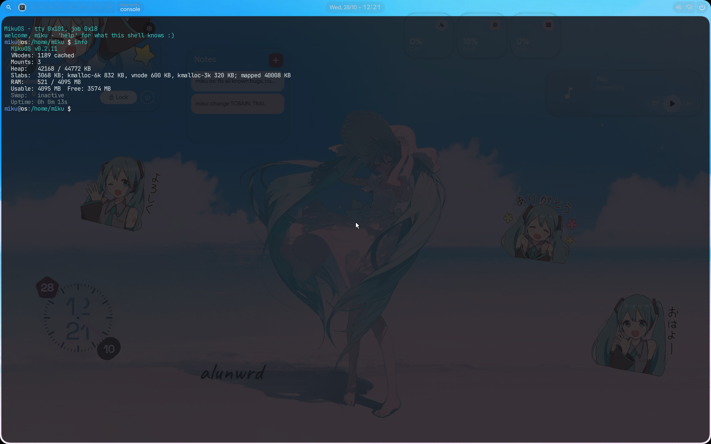
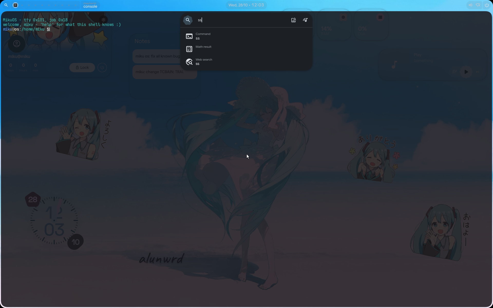

<div align="center">

# Miku OS

**Полноценная операционная система для x86_64, написанная с нуля на Rust**

*Powered by Rust and one developer*


[](https://www.rust-lang.org/)
[]()
[]()
[]()
[]()

<div align="center">

### Графический вход (`maygreet`)
<a href="screenshots/login.png">
  
</a>

<br><br>

### Рабочий стол: `aosh` + `maywm`, и `msh` в `mayterm` с командой `info`
<a href="screenshots/desktop.png">
  
</a>

<br><br>

### Лаунчер `aosh`
<a href="screenshots/launcher.png">
  
</a>

<p><em>(Снято в QEMU, где рабочий стол собирается процессором: тени, скруглённые углы и рамки рисуются
и там, но размытие и плавные появления и исчезновения на RTX 5060 Ti дают вычислительный проход
видеокарты. Нажмите на скриншот, чтобы открыть его в полном разрешении.)</em></p>

</div>

</div>

---

> **Переводы:** [Русский](Russian_README.md), [English](English_README.md), [日本語](Japanese_README.md)
> **Справочник ABI:** [MikuOS_ABI.md](MikuOS_ABI.md) · **Модель безопасности:** [MikuOS_Security.md](MikuOS_Security.md)
> **NVIDIA:** [GB206 / RTX 5060 Ti](Nvidia_gb206.md) · [TU116 / GTX 1650](Nvidia_tu116.md)
> **Справочная документация:** [WIKI.md](../WIKI.md) (оглавление [docs/wiki/](wiki/)) · **Рабочие заметки (архитектура, решения, замеры):** [dev/](../dev/README.md)

---

## О проекте

**Miku OS** - операционная система, написанная с нуля в окружении `no_std` на Rust. Под ядром нет
библиотеки C и нет рантайма хоста: раскладка памяти, обработка прерываний, планировщик, файловые системы,
драйверы, дисплейный сервер и драйвер видеокарты написаны здесь. Программы над ядром получают собственную
библиотеку C системы, `libc_miku`, написанную на Rust, и Rust `std` поверх неё.

Что работает сегодня:

- вытесняющее SMP-ядро с процессами **и потоками**, futex, сигналами в форме Linux и vDSO;
- терминалы: псевдотерминалы, сессии, группы процессов и управление заданиями; оболочка (`msh`) в ring 3;
- VFS поверх tmpfs, ext2/3/4, btrfs (только чтение) и memfs, со страничным кешем, отложенной записью
  для файлов на диске и inotify;
- стек TCP/IP в ядре, а DNS, TLS 1.3 и HTTP в ring 3;
- **Mayland** - дисплейный сервер и композитор, и рабочий стол на нём: оконный менеджер в духе Hyprland
  (`maywm`), терминал (`mayterm`) и **aosh** - оболочка рабочего стола на QML с настоящим JavaScript;
- собственный **драйвер NVIDIA** для RTX 5060 Ti (GB206, Blackwell): загрузка GSP-RM, вывод по DisplayPort,
  сканирование из видеопамяти, вычислительный канал, который размывает, затеняет и рисует рабочий стол
  на карте;
- **порт Rust `std`**: `std::thread`, `std::sync`, `std::net`, `tokio`, `smol` - и на нём работает
  **редактор Zed**;
- **собственная libc** (`libc_miku.so`, около 540 экспортируемых функций, написана на Rust) с заголовками C,
  поэтому библиотеки на C - SQLite, zstd, tree-sitter, FreeType - собираются и линкуются с ней;
- вход в систему и повышение прав **без setuid-бита**, через брокер; пароли на Argon2id;
- пакетный менеджер (`mikupkg`) и установщик.

> Весь код - на Rust, кроме перечисленных выше вендоренных библиотек на C. Ассемблер есть только в точке
> входа загрузки, во входах системных вызовов и исключений, в трамплине AP и в переключении контекста -
> там, где соглашение о вызовах должно быть точным.

**Объём:** ~182 000 строк ядра в 463 файлах; ~140 000 строк библиотек (драйверы ext и btrfs, libmiku,
дисплейный протокол, сетевые протоколы, пакетный менеджер, порт `std`); ~66 000 строк программ
(`system/`, `utils/`, `aosh/`, `apps/`, `stdapps/`).

---

## Ядро

| Компонент | Описание |
|:--|:--|
| **Архитектура** | x86_64, `#![no_std]`, `#![no_main]` |
| **Загрузка** | GRUB2 + Multiboot2, загрузка через BIOS (под UEFI `multiboot2` в GRUB 2.14 падает). Ранняя консоль рисует каждую фазу загрузки во framebuffer ещё до появления настоящей консоли. Каждый шаг загрузки печатает своё имя, а если он занял 5 мс или больше, то и миллисекунды; собственная загрузка ядра в QEMU/KVM занимает около 115 мс |
| **Адресное пространство** | Ядро в верхней половине с `0xFFFFFFFF80000000`, прямое отображение HHDM с `0xFFFF800000000000` |
| **Защита процессора** | NX, WP, SMEP и SMAP включены; флаг направления сбрасывается при каждом входе из ring 3; состояние FPU/SSE принадлежит каждой задаче и сохраняется при переключении |
| **Прерывания** | IDT, LAPIC + IO-APIC (8259 замаскирован), MSI и MSI-X для NVMe (вектор на каждую очередь), AHCI, virtio-net и видеокарты |
| **Таймер** | LAPIC-таймер на 250 Гц, откалиброванный по PIT; очереди таймеров на каждом CPU для сна в наносекундах и таймаутов `poll` |
| **SMP** | До 64 CPU; ACPI MADT, INIT/SIPI, GDT/TSS/GS на каждый CPU. Сброс TLB рассылается только тем CPU, на которых загружено это адресное пространство |
| **Планировщик** | vruntime в стиле CFS, очереди на каждый CPU в виде куч, размещение и перехват работы, опрос в простое перед `hlt`, до 32 768 задач |
| **Куча ядра** | Слабы по классам размеров с магазинами на каждый CPU; всё больше 32 КиБ - из `vmap`; шринкеры возвращают память под нагрузкой; `slabdebug` проверяет каждый объект |
| **Стеки ядра** | Отображены в `vmap` со страницами-стражами: 128 КиБ для задачи программы, 512 КиБ для потока ядра |
| **Системные вызовы** | 124 (0-123, все номера заняты) через `SYSCALL`/`SYSRET`; `sigreturn` возвращается через `iretq` |
| **vDSO** | `clock_gettime`, `gettimeofday` и `getcpu` без системного вызова (`Instant::now` стоит 11 нс) |
| **Часы** | CMOS при загрузке; их выставляет `mikudo ntpdate` или `clock_settime` (автоматической синхронизации по NTP нет) |
| **Журнал ядра** | Записи с уровнями в памяти (`klog`), три кольца по уровням, чтобы болтовня никогда не вытеснила ошибку; читается через `dmesg`; `pstore` сохраняет выбранные строки через тёплую перезагрузку (весь журнал - с `klogpstore`); в обратных трассах есть имена символов |

### Блокировки и ожидания

- **`SchedMutex` / `SchedRwLock`** (`kernel/kcore/sched_lock.rs`) недолго крутятся, а потом засыпают.
  Блокировка VFS и блокировка страничного кеша - read-write: `stat`, `open`, `getdents`, `close` и чтения из
  кеша идут рядом друг с другом. Чтение дескрипторов вообще не берёт блокировку (счётчик последовательности
  на каждый слот).
- **`IrqMutex`** - для всего, чего касается обработчик прерывания; обработчик таймера не берёт блокировок
  вообще.
- **Очереди ожидания** везде, где задача ждёт. Ни одно ожидание не проверяет условие и не засыпает на нём
  отдельно: это потерянное пробуждение, и каждое найденное стоило задержки в 100 мс.
- **`/proc/lockstat`** (с `lockstat` в строке загрузки): сколько раз каждую спящую блокировку брали и сколько
  раз за неё боролись, время удержания по корзинам, самое долгое удержание и место, где его взяли, и чтения
  и записи диска, сделанные под блокировкой VFS.

### Защита памяти самого ядра

Каждое из этого существует, потому что поймало настоящую, трудно диагностируемую ошибку:

- **Страницы-стражи стеков** - переполнение падает на той инструкции, которая его сделала, и отказ
  называет задачу.
- **`slabdebug`** - отравленные объекты с красными зонами: запись за конец, двойное освобождение и запись
  после освобождения сообщаются там, где они случились.
- **`IrqMutex`** - простой спинлок, взятый обработчиком прерывания, приводит к взаимной блокировке CPU с
  самим собой.
- **Copy-on-write только для чтения до сброса TLB** - соседний CPU никогда не пишет через устаревшую запись.

---

## Управление памятью

| Часть | Подробности |
|:--|:--|
| **Физическая** | Битовая карта по старшему доступному кадру; счётчики copy-on-write - один атомик на кадр; кеши кадров на каждый CPU для отказов страниц |
| **Виртуальная** | Четырёхуровневая страничная адресация за типом `AddressSpace`; половина ядра общая для всех адресных пространств |
| **Отказы страниц** | Подкачка по требованию с fault-around (16 страниц, если отображена предыдущая); copy-on-write через `fork` |
| **mmap** | Анонимные (только частные), файловые, `MAP_SHARED` для файла (собственные кадры файла tmpfs), `mprotect`, `msync` |
| **Своп** | Обратное отображение, вытеснение по кругу со старением, PTE свопа с сохранением исходных флагов; освобождение памяти - в потоке **kswapd**. Одно устройство свопа размером до 256 МиБ, и выгружаться могут только кадры из первых 256 МиБ физической памяти |
| **Страничный кеш** | Страницы файла на диске; при попадании читаются без блокировки VFS; записываются потоком bdflush, `fsync` или при превышении лимита грязных страниц |

---

## Процессы, потоки и сигналы

| Возможность | Подробности |
|:--|:--|
| **Модель** | Задача на каждый поток; потоки процесса образуют группу потоков (`tgid`), чьи дескрипторы, память и права разрешаются через лидера |
| **Создание** | `fork` (copy-on-write), `exec`/`execve`, `wait4` со словом статуса POSIX, `thread_create`/`thread_exit`, `gettid` |
| **Ограничения потоков** | Нет `clone` с флагами; `exec` из потока, который не лидер, отклоняется |
| **Синхронизация** | `futex` (ожидание, пробуждение, таймауты; страница tmpfs с `MAP_SHARED` получает ключ по своему кадру, поэтому futex работает между процессами), поэтому `std::sync` не нужен код под MikuOS. Нет requeue, наследования приоритета и robust-списков |
| **Сигналы** | Сигналы 1-31 с раскладкой `siginfo_t` и `ucontext_t` как в Linux: обработчик получает всё состояние машины и может его переписать (wasmtime так и делает). `SA_RESTART` принимается, но ни на что не влияет. Исключения CPU - это сигналы: `#PF` - `SIGSEGV`, `#UD` - `SIGILL`, `#DE` - `SIGFPE`; `sigaltstack` - на каждый поток |
| **Терминалы** | Сессии, группы процессов, управляющие терминалы, `SIGTTIN`/`SIGTTOU`, управление заданиями |
| **Когда программа падает** | Отчёт о сбое называет исключение и стек с символами; ELF-дамп памяти ложится в `/tmp` для отладчика |
| **Загрузчик ELF** | Защищён от враждебных образов; самотест собирает их в памяти |
| **Права** | uid/gid, дополнительные группы, capabilities (`capget`/`capset`), сессии как объекты ядра |

---

## Системные вызовы

124 номера (0-123, все заняты); полная таблица с аргументами и ошибками - в [MikuOS_ABI.md](MikuOS_ABI.md).

| Номера | Область |
|:--|:--|
| 0-17 | `exit`, `write`, `read`, `mmap`, `munmap`, `mprotect`, `brk`, `getpid`, `getcwd`, TLS, `open`, `close`, `seek`, `fsize`, `map_lib`, `sleep`, `uptime` |
| 18-42 | файлы: `stat`, `fstat`, `mkdir`, `rmdir`, `unlink`, `readdir`, `rename`, `link`, `chmod`, `chown`, `dup`, `dup2`, `write_file`, `truncate`, `symlink`, `readlink`, `pipe`, `chdir`, `statfs`, `fallocate`, xattr, `utimensat`, `fsync`, `punch_hole` |
| 43-55 | `fork`, `wait4`, `kill`, `exec`, `umask`, вызовы uid/gid |
| 56-59, 62-66, 77, 80, 83-85, 114 | сокеты: `socket`, `connect`, `send`, `recv`, `bind`, `listen`, `accept`, `sendto`, `recvfrom`, `socketpair`, опции сокетов, `peercred`, `sendfd`/`recvfd` |
| 60-61, 67-71 | `mmap_file`, `msync`, `execve`, `sigentry`, `sigreturn`, `clock_gettime`, `ioctl` |
| 72-76, 78-79, 81-82 | пулы дисплея, `klog`, `poll`, `getrandom`, `clock_settime`, список и удаление xattr |
| 86-93 | `setresuid`, `setresgid`, `setgroups`, `getgroups`, `capget`, `capset`, `session`, `power` |
| 94-98, 121 | видеокарта: `gpu_info`, `gpu_submit`, `gpu_bind`, `gpu_wait`, `gpu_program`, `gpu_alloc` |
| 99-105 | `tty`, `sigdisp`, `setpgid`, `getpgid`, `procinfo`, `kcmd`, `proc_path` |
| 106-120 | потоки (`thread_create`, `thread_exit`, `gettid`, `sched_yield`, `futex`), `getdents`, `lstat`, `fcntl`, `getsockopt`, `sigaltstack`, inotify (116-118), `realpath`, `pipe2` |
| 122-123 | `sleep_ns`, `poll_ns` |

Старшая половина длины аргумента-пути называет дескриптор каталога - так выражаются вызовы `*at`, `fchmod`
и `F_GETPATH`; пустой путь вместе с дескриптором называет файл самого дескриптора. Каждый пользовательский указатель проверяется постранично, а пути копируются в ядро до
использования.

---

## Виртуальная файловая система

| Свойство | Значение |
|:--|:--|
| Vnode | Динамическая таблица с LRU и шринкером; освобождаются пачками |
| Имена | Записи каталогов - отдельные объекты: псевдонимы жёстких ссылок, кеш inode, отрицательные записи, whiteout; номера inode стабильны |
| Открытых файлов на процесс | 512 |
| Длина имени | 255 байт |
| tmpfs | Кадры памяти, до четверти ОЗУ; файлы до 4 ГиБ |
| Типы файловых систем | tmpfs, devfs, procfs, ext2, ext3, ext4, btrfs (только чтение), memfs |

- **Файловые системы за одним трейтом** (`FileSystem`) и одним реестром; ничто в VFS не называет формат.
- **Поиск имён без блокировки**: имя, которого нет в кеше, читается с диска при отпущенной блокировке VFS и
  добавляется, если каталог за это время не изменился.
- **Страничный кеш для файлов на диске**: чтение из кеша не берёт блокировку VFS; записи ложатся в него
  грязными страницами и записываются через `fsync`, bdflush (страницы старше пяти секунд) или писателем,
  превысившим лимит грязных страниц. Блоки и страницы большого файла освобождаются после блокировки, а не
  под ней.
- **inotify** с ABI Linux; каналы - анонимные vnode; блокировки записей POSIX (`fcntl`).
- В `/proc` двенадцать файлов: `version`, `uptime`, `meminfo`, `mounts`, `cpuinfo`, `stat`, `heap`, `diskstats`,
  `net`, `clock`, `slabinfo` и `lockstat`. Каталогов процессов нет.

---

## Файловые системы

### ext2 / ext3 / ext4 (`lib/fs/extfs`, монтируется в `kernel/fs/ext/`)

Драйвер - отдельный крейт, который знает формат на диске и ничего не знает об этом ядре: до диска он
доходит через один трейт (`BlockHost` из `lib/fs/fshost`). Смысл - в цикле тестов: `cd lib/fs/extfs && cargo test`
собирает файловую систему в памяти, намеренно портит её, обрывает питание посреди транзакции и проверяет,
что делает драйвер, - за секунды, а не за загрузку.

| Возможность | Подробности |
|:--|:--|
| **Чтение** | Прямые, косвенные, двойные и тройные косвенные блоки; деревья экстентов ext4; inline-данные |
| **Запись** | Экстенты выделяются и освобождаются диапазонами; данные файла идут прямо на устройство, данные нового блока - раньше экстента, который на него ссылается; блоки, освобождённые открытой транзакцией, не выдаются снова до её коммита |
| **Каталоги** | Хеш-индекс (`dir_index`) читается и пишется: индекс строится при росте, листья делятся по границе хеша, дерево получает уровень |
| **Журнал ext3** | JBD2: транзакции с хэндлами, блоки дескрипторов и отзыва, порядок write-ahead через пины, воспроизведение при монтировании, список сирот, crc32c по журналу |
| **ext4** | Деревья экстентов любой глубины, незаписанные экстенты для `fallocate`, свойство `64bit` (внутри номера блоков пока 32-битные), flex_bg, наносекундные и пост-2038 метки времени |
| **Контрольные суммы** | crc32c (SSE4.2, если есть) по каждой структуре метаданных |
| **Целостность** | Пятипроходная проверка и починка (`extfsck`), очистка сирот, TRIM, `fiemap` |
| **mkfs** | ext2/ext3/ext4, ext4 с `metadata_csum` |

Проверяется против e2fsprogs, а не против самого себя: `e2fsck -f -n` на каждом образе из тестов, контрольные
суммы воспроизводятся по образам `mke2fs`, в индекс каталога, построенный `e2fsck -D`, пишется, и его
обходит `debugfs`, а питание обрывается на каждой записи операции, и каждый получившийся образ отдаётся
`e2fsck`.

### btrfs (`lib/fs/btrfs`)

В ядре только чтение: дерево чанков, деревья файловых систем, экстенты, inline-файлы. В крейте есть и
транзакции copy-on-write, аллокатор и коммиты - проверены на хосте сборки на образах `mkfs.btrfs`.

### Другие

- **tmpfs** - корневая файловая система; **memfs** - монтируемая файловая система без носителя, на которой
  VFS проверяется против второго формата; **devfs**, **procfs**
- **GPT** - разбор таблицы разделов, узлы разделов, `partprobe`
- **Установщик** - `install plan` / `install go` в консоли или окно, которое задаёт те же вопросы

---

## Стек хранения

```
VFS → страничный кеш → файловая система → блочный уровень (кеш, bdflush) → драйвер → устройство
```

- **Блочный уровень** (`kernel/io/block/`): реестр устройств, разделы, статистика по устройствам, discard и
  write-zeroes, здоровье (страницы журналов NVMe, ATA SMART), `/proc/diskstats`
- **Драйверы** (`kernel/drivers/block/`): `nvme` (очередь ввода-вывода на каждый CPU, вектор MSI-X на
  каждую очередь), `ahci` (MSI), `ata` (PIO + bus-master DMA), `virtio_blk`, `ramdisk` (образ прошивок,
  который передаёт GRUB). Ожидающий опрашивает 50 мкс, а потом засыпает.

---

## Сетевой стек

| Уровень | Поддержка |
|:--|:--|
| **Драйверы** | Семейство Intel e1000, Realtek RTL8139 и RTL8111/8168 (PCI id 8169 отдаётся драйверу RTL8139), virtio-net (переходный id 1af4:1000) с MSI-X |
| **Канальный / сетевой** | Ethernet, ARP, IPv4, ICMP |
| **Транспортный** | UDP; TCP с повторной передачей и слушателями (состояний `TIME_WAIT` и `CLOSING` пока нет); выбор портов по RFC 6056 |
| **В ring 3** (`lib/net`) | DNS (`getaddrinfo`), HTTP/1.1, HTTP/2, NTP, клиент TLS 1.2/1.3 с проверкой сертификатов по корням из `/etc/ssl/certs/ca-bundle.pem` - нет хранилища доверия, нет и соединения |
| **Сокеты** | AF_INET (TCP, UDP, raw ICMP), AF_UNIX с `peercred` и передачей дескрипторов, AF_MAYLAND |

`netd` выполняет DHCP при загрузке. `ping`, `traceroute`, `wget`, `curl`, `host` и `ntpdate` - программы в `/bin`.
Интерфейса loopback нет, а `shutdown`, `getsockname` и `getpeername` пока не реализованы.
Полный справочник - [docs/wiki/network.md](wiki/network.md).

---

## Графика: Mayland, рабочий стол и видеокарта

### Mayland (`kernel/mayland/`, `lib/gfx/mayland/`)

Дисплейный сервер и композитор. Его протокол использует формат сообщений Wayland поверх собственного
семейства сокетов; разделяемая память - это хэндл ядра, раскладка клавиатуры - таблица. Одна копия протокола
и растеризатора шрифтов собирается и в сервер, и в каждый клиент (`libmay`).

- **Композиция**: отслеживание изменённых областей, окна со скруглёнными углами-сквиркалами, рамки, тени и
  размытие, анимации по кривым, послеобраз закрывающегося окна, слои над окнами и под ними, всплывающие
  окна, буфер обмена, аппаратная плоскость курсора.
- **Управление окнами** - это программа: **`maywm`** читает конфиг в духе Hyprland (`/etc/mayland/default.d/*.conf`, затем
  `may.conf`, затем `conf.d/*.conf`; побеждает более поздняя строка): тайлинг, рабочие столы, правила,
  бинды, `exec-once`, мониторы. Строка, которую никто не понял, сообщается, а не выбрасывается.
- **Выходы**: режимы из EDID монитора; рабочий стол собирается на одном выходе (вторая голова написана, но
  ещё не запускалась); дисплейный уровень (`kms`) над драйверами принимает атомарные запросы с пробной
  проверкой, а строки `monitor =` в `maywm` - как в Hyprland.
- **Клиенты**: `mayterm` (окно, в котором оболочка работает на своём pty), `maygreet` (экран входа),
  `maysession`, установщик, `maydemo`, Zed.

### aosh - оболочка рабочего стола (`aosh/`, `etc/aosh/`)

aosh для MikuOS - то же, что quickshell для Hyprland: одна программа, которая читает каталог QML-файлов и
рисует по ним панель, лаунчер, обзор и всплывающие окна. Язык - подмножество QML; каждое выражение и функция -
настоящий JavaScript (QuickJS). Текст рисуется через FreeType и rustybuzz и совпадает с
глифами Qt пиксель в пиксель; прямоугольники, глифы, Canvas и эффекты рисуются так же, как их рисует Qt
Quick (в пределах 1-2/255 от Qt), - на карте через вычислительную программу, иначе процессором. В комплекте -
порт настоящего конфига quickshell (`etc/aosh/negi`, запускается как `aosh -c negi`). Свой конфиг кладите
в `~/.config/aosh`, потому что `/etc` - это загрузочный образ только для чтения. См.
[docs/wiki/aosh.md](wiki/aosh.md) и [docs/wiki/mayland.md](wiki/mayland.md).

### На карте

На RTX 5060 Ti композитор работает на вычислительном движке видеокарты: размытие, тени, скругление углов и
сборка окон - это программы для GPU, каждое окно хранится в видеопамяти (туда его копирует движок
копирования; `notex` это выключает), и собственное рисование aosh - тоже программа для GPU. Поверхность,
которую вычислительный проход взять не может, смешивает процессор. Это работа драйвера, о нём ниже.

---

## Драйвер NVIDIA (`kernel/drivers/gpu/nvidia/`)

Собственный драйвер для **GeForce RTX 5060 / 5060 Ti (GB206, Blackwell)**, около 52 000 строк в 130 файлах,
написанный по опубликованным исходникам `nvidia-open` (OpenRM), функция за функцией. Это не порт: ни C, ни
прослоек Linux. Он загружает прошивку GSP-RM карты и говорит с ней так же, как OpenRM, а пути вывода
изображения, памяти и вычислений поверх - собственные, этого ядра. Заметки по архитектуре - в
[`dev/`](../dev/README.md) (`gsp-foundation.md`, `gsp-615.md`, `gb206-display.md`, `gpu-memory-compute.md`,
`kms-architecture.md`, `gpu-perf.md`); пользовательские заметки - [Nvidia_gb206.md](Nvidia_gb206.md).

### Запуск карты

```
опрос PCI → BAR0/BAR1 → цепочка доверия FSP (MCTP поверх EMEM) → GSP-FMC → работает GSP-RM 615
          → поднят транспорт RPC → system info, registry, static info → дерево объектов RM → движки
```

- **Загрузка через FSP** (`blackwell/fsp.rs`, `fmc.rs`, `gspboot.rs`): на Blackwell хост сам не запускает
  falcon. Он кладёт GSP-FMC и образ GSP-RM в системную память и отправляет FSP одно сообщение цепочки
  доверия; FSP проверяет FMC, FMC выделяет защищённую область и запускает GSP-RM.
- **Одна версия прошивки**: драйвер говорит с GSP-RM **615.78.08** - прошивка и код, который с ней говорит,
  из одного релиза, как в OpenRM. GSP-RM и микрокоды (ucode) извлекаются из пакета драйвера NVIDIA, а FMC и
  загрузчик собираются из bindata OpenRM 615.78.08 (`dev/nvidia/fw_extract.py` с `--tree refsrc/openrm`);
  всё это упаковывается в образ ext2 и передаётся модулем GRUB.

### Разговор с GSP-RM (`gsp_common/`)

- **Транспорт** (`rpc/`): очередь сообщений 615 (MSGQ 2.0 с кадрированием MCTP/NVDM), один путь приёма со
  списком разрешённых при загрузке событий как в OpenRM, проверки заголовка (версия MCTP, вендор, магическое
  число, размер), ответы, сопоставленные по функции и номеру последовательности, и проверка исправности
  перед каждым вызовом.
- **Жизненный цикл** (`kgsp/`): обработчик прерывания трогает только атомики, а нижняя половина - рабочий
  поток; события, проверки здоровья, **выгрузка и повторная загрузка без перезагрузки машины**, отчёты
  CrashCat.
- **RM API** (`rmapi.rs`): каждый объект выделяется через клиента RM с настоящими родителями - клиент,
  устройство, подустройство, память, каналы, дисплей - то дерево, которого ждёт GSP-RM.
- **Журналы**: собственный журнал GSP-RM декодируется (`logdecode.rs`); каждый RPC и вызов RM со статусом
  идёт в журнал ядра на уровне debug, ошибки robust-channel, Xid и CrashCat - на уровне error (`nvidia log`).

### Память

- **Собственный GPU MMU** (`gmmu.rs`, `vaspace.rs`): таблицы страниц строятся здесь, со страницами 4K, 64K и
  2M и сбросом TLB; BAR1 отображён для записи процессором в видеопамять.
- **Аллокатор видеопамяти** (`gsp_common/vram.rs`) и **пулы, которые программа может отобразить**
  (`gpu_alloc`): окно, чей буфер - видеопамять, композитор читает на месте - это DMA-BUF MikuOS.

### Каналы, копирование и вычисления

- Каналы GPFIFO с push-буферами и семафорами; **copy engine** для загрузок и копий окон; **вычислительный
  канал**, который запускает программы через QMD (`qmd.rs`), по несколько в одной отправке.
- **Программы для GPU** написаны на CUDA C (`shaders/*.cu`: blur, composite, fill, over, paint),
  компилируются `nvcc` при сборке и читаются собственным разборщиком cubin MikuOS (`cubin.rs`) - тот же
  разборщик проверяет их при сборке и загружает в ядре.
- **Пользовательские программы**: `gpu_program` (98) загружает программу, которую передал процесс, при
  наличии `CAP_GPU`; `gpu_submit`, `gpu_bind`, `gpu_wait` и `gpu_info` дополняют интерфейс (`apps/gpudemo`).

### Вывод изображения (`blackwell/display.rs`, `gsp_common/modeset/`, `kernel/drivers/gpu/kms/`)

- Тренировка линка **DisplayPort**, **HDMI**, IMP (проверка пропускной способности и частот дисплея), головы
  и окна, сканирование из видеопамяти, режимы из EDID монитора.
- **Цветовой конвейер**: входной LUT, преобразование цветового пространства, выходной LUT, дизеринг и
  ограничение, в порядке железа. Входной LUT - в half-float; экран был чёрным неделями, пока туда писали
  16-битную фиксированную точку.
- **Плоскость курсора** по умолчанию, смена кадров окна с семафором переключения; **вторая голова** и VRR
  написаны, но на панели ещё не запускались.
- **KMS** (`kms/`): слой над драйвером с объектами DRM и атомарными запросами с пробной проверкой; выходы
  названы так, как их называет nvidia-drm (`DP-1`, `HDMI-A-1`), поэтому строка `monitor =` из Hyprland
  работает без изменений (проверено в QEMU; на карте ещё не запускалось).

### Питание и частоты (`gsp_common/perf/`)

Частоты меняет прошивка; драйвер читает то, что она сообщает, - частоты, загрузку, мощность и температуры
со страницы, куда их пишет GSP-RM, и историю PMU - и просит boost, фиксацию частоты или нижнюю границу так
же, как это делает клиентская ОС в OpenRM.

### Диагностика и запасные выходы

- `run=nvidia_selftest` - 184 случая, без экрана; через `run=` идёт и **тест выгрузки и повторной загрузки
  GSP** без участия человека, и его журнал переживает тёплую перезагрузку (`pstore`).
- Оболочка ядра: `nvidia` (`gb206`, `log`, `perf`, `rm-tree`, `gsp unload` / `gsp load` / `gsp reset`,
  `selftest`), `display`, `mayland status`. Все подкоманды перечислены в
  [Nvidia_gb206.md](Nvidia_gb206.md#commands).
- Флаги GRUB: `nogpu` (не трогать карту), `nointr` (все ожидания GPU опросом), `nononstall` (заборы опросом),
  `nobar1` (запись через PRAMIN), `gpu4k` (только страницы 4K), `notex` (окна читаются из системной памяти),
  `nohwcursor` (программный курсор), `noflipsema`, `nobackdrop` (без размытия подложки), а также запасные
  выходы порядка загрузки `gspbase`, `pciebase`, `coldhead` и `edidbase`. Полная таблица - в [Nvidia_gb206.md](Nvidia_gb206.md#boot-flags).

### Turing

Путь **TU116 / GTX 1650** (`turing/`) выполняет начальную инициализацию со стороны хоста и готовит образ
GSP-RM при загрузке. Полная шестиэтапная загрузка GSP-RM (FWSEC, WPR2, SEC2, booter) запускается только по
запросу (`nvidia gsp-rm-boot-full`), и от неё пока не ждут, что она дойдёт до конца; на карте Turing она не
запускалась ни разу. TU117 получает только инициализацию со стороны хоста. Вывода изображения и вычислений
там нет ([Nvidia_tu116.md](Nvidia_tu116.md)).

---

## Ввод и терминалы

- **Клавиатура** - PS/2 и USB HID (xHCI, разборщик HID-отчётов); собственные раскладки; автоповтор - от
  аппаратного typematic (только PS/2: зажатая клавиша на USB-клавиатуре пока не повторяется).
- **Мышь** - PS/2 и USB.
- **Терминалы** (`kernel/io/tty/`) - таблица pty, где мастера - это дескрипторы (`/dev/ptmx`, `/dev/ptsN`),
  `termios` на каждый терминал (канонический и сырой режимы, эхо, сигнальные символы), размеры окна,
  `/dev/tty`, hangup. Всего восемь терминалов: консоль и семь pty. См.
  [docs/wiki/input-and-terminals.md](wiki/input-and-terminals.md).
- **Консоль** - текстовая консоль во framebuffer, которая никогда не читает framebuffer обратно, с копией в
  последовательный порт. Когда поднят рабочий стол, консоль ядра - только последовательный порт; паника всё
  равно рисуется.

---

## mikuD - демон инициализации

PID 1: поток ядра с фиксированной таблицей на 32 службы. Он отвечает за их жизненный цикл, зависимости и
перезапуски.

| Понятие | Значения |
|:--|:--|
| **Цели** | `SysInit`, `MultiUser`, `Graphical`, `Rescue` |
| **Политики перезапуска** | `Always`, `Never`, `OnFailure`, `OnSuccess`, `OnAbnormal` |
| **Точка входа службы** | Функция ядра `fn()` или путь к ELF-программе (при обычной загрузке `/bin` - это модуль GRUB только для чтения) |
| **Дополнительно** | Граф зависимостей, порядок, задержки перезапуска, маскирование, журнал, файлы `.service`, `User=` и `Capabilities=`, применяемые до первой инструкции службы. Watchdog и `Type=notify`: служба отчитывается через `mikuctl notify --ready`/`--watchdog`. Времена `*Sec` задаются в секундах (суффиксы `ms`, `s`, `min`). Таймеры и активация по сокету есть в коде, но запустить их пока нечем |

Службы, запускаемые при загрузке: `kbd`, `usbd` (кроме загрузки с `nousb`), `netd`, `bdflush`, `kswapd`,
`mikudod`, `shell`, а на графической цели - `compositor` и `greeter`. Полный справочник -
[docs/wiki/system.md](wiki/system.md).

---

## Пользовательское пространство

### Rust `std` (`lib/sdk/rust-std/`)

`std` для `target_os = "miku"`: платформенный слой вызывает `libmiku`, а не системные вызовы, поэтому номера
знает одна библиотека. Работают `fs`, `path`, `env`, `io`, `process`, `net`, `time` (через vDSO), `thread`,
`sync` (на futex) и `thread_local`; `tokio`, `smol` и `polling` работают на `poll`. Объявлено
`target_family = "unix"`, поэтому собираются крейты, которые ветвятся по `unix`. Программы в `stdapps/` - это
наборы тестов (`stdfs`, `stdthreads`, `stdtokio`, `stdpty`, `stdwatch`, `stdsignal`, ...) и `stdbench`,
который собирается и под Linux, чтобы их можно было сравнить. Чего пока нет: IPv6, `File::lock`, таймаутов
сокетов, `shutdown`, `local_addr`/`peer_addr` и привязки к порту 0.

**Zed** - редактор - собирается для MikuOS из собственных исходников с несколькими патчами и четвёртым
бэкендом gpui, который говорит на Mayland. Он лежит пакетом в образе и запускается с рабочего стола.

### libc и C (`lib/runtime/libmiku/`, `lib/sdk/c/`)

**`libc_miku.so`** - библиотека C для MikuOS, написанная на Rust: около 540 экспортируемых функций (около
1450 во всех десяти библиотеках `miku`). Она покрывает `stdio` (семейства `printf`/`scanf`, `FILE`),
`string`, `stdlib`, `ctype`, `math`, `malloc` на куче с корзинами, `time`/`ctime`, `dirent`, `poll` и
`select`, сокеты и `getaddrinfo`, `termios` и pty (`openpty`, `posix_openpt`, `login_tty`), `pwd`/`grp` с
`getgrouplist`, вызовы `*at`, `setjmp`/`longjmp`, `getauxval` и потоки POSIX - `pthread_create`, мьютексы
(в том числе разделяемые между процессами), условные переменные с выбором часов, rwlock, `pthread_once`,
ключи, `pthread_atfork`. Чего пока нет: `dlopen`, `posix_spawn`, `epoll`, `eventfd`, `signalfd`, `timerfd`
и локалей; `getaddrinfo` - только IPv4, а `localtime` - это UTC.

В `lib/sdk/c/include/` лежат заголовки C для неё - 47 штук, от `stdio.h` до `sys/socket.h` и
`pthread.h`. Это её C-лицо, а не вторая libc: заголовок объявляет только то, что библиотека определяет,
поэтому программа на C, которой нужно то, чего в MikuOS нет, не *соберётся*, а раскладка каждой структуры
закреплена за Rust-оверлеем `libc` через `_Static_assert`, которые проверяются при каждом изменении
заголовка. `lib/sdk/c/miku-cc` оборачивает clang хоста с флагами цели. Так собраны SQLite, zstd, tree-sitter и FreeType, и через ту же обёртку
собирают C Rust-крейты, которые компилируют его через `cc`.

### Динамическая компоновка

`ld-miku` - динамический загрузчик: релокации, `DT_NEEDED`, собственный TLS программы (`PT_TLS`; библиотека
с TLS пока не загружается), полный auxv, и auxv передаётся libmiku до любого конструктора. `dlopen` нет, а
путь поиска фиксирован (`/lib`, `/usr/lib`, `/usr/local/lib`). Библиотеки `miku` заранее загружены в
`/lib` и разделяются между процессами: `core_miku`, `sys_miku`, `text_miku`, `ds_miku`, `algo_miku`,
`codec_miku`, `fs_miku`, `net_miku`, `parse_miku`, `libc_miku`. Куча ring 3 использует раздельные корзины с кешами на каждый поток.

### Пользователи и привилегии

MikuOS загружается в экран входа: графический, если есть где его нарисовать, и консоль, спрашивающую, кто
вы, если нет, - тот же вход, через тот же брокер, нарисованный текстом.

**В этой системе нет setuid-бита, нет setgid-бита и нет файловых capabilities.** `exec` читает биты режима
файла, а загрузчик их игнорирует, поэтому привилегии выдаёт привилегированный процесс своему потомку, и
их никогда нельзя получить из файла. Это убирает весь класс ошибок, которые `sudo`, `doas` и `pkexec`
находят у себя тридцать лет; [MikuOS_Security.md](MikuOS_Security.md) перечисляет эти бюллетени.

Повышение прав - это брокер: `/bin/mikudo` работает от вашего имени, без какой-либо власти, и просит
`/bin/mikudod` - запущенного mikuD - через локальный сокет; ядро называет вызывающего через `peercred`.
Экраны входа - клиенты того же брокера: `login` и `maygreet` работают от непривилегированной учётной записи
`greeter`, а `mikudod` - единственный процесс, который читает `/etc/shadow` и тратит Argon2id.

```
login: miku
password for miku:

Welcome, miku.
miku@os:/ $ id
uid=1000(miku) gid=1000(miku) groups=1000(miku),10(wheel),100(users)
miku@os:/ $ cat /etc/shadow
  /etc/shadow: permission denied
miku@os:/ $ mikudo id
[mikudo] password for miku:
uid=0(root) gid=0(root) groups=0(root)
```

Сессия - это объект ядра: личность, место (seat) и процесс, который её ведёт. У неё одна capability,
`CAP_MAY_PRIV`, и она следует за местом: она у greeter, пока никто не вошёл, и ядро забирает её в тот момент,
когда кто-то входит. Пока greeter на экране, композитор держит фокус на нём, и все сочетания клавиш
оконного менеджера отключены. Домашний каталог создаётся из `/etc/skel`, когда впервые запускается графическая сессия.

Программы: `mikudo`, `mikudod`, `login`, `maygreet`, `maysession`, `passwd`, `id`, `su`, `useradd`.
Хеш и все разборщики - в `lib/admin/mikuauth`: `cargo test` прогоняет около сотни случаев, включая эталонный тег Argon2id
из RFC 9106.

### Пакеты (`lib/admin/mikupkg`, `/bin/mikupkg`)

Формат контейнера, решатель зависимостей и транзакция с журналом, которая откатывается назад и никогда не
доигрывается вперёд. Единственная связь применителя с миром - трейт `Root`, поэтому сборщик ставит пакеты в
образ тем же кодом, которым `/bin/mikupkg` ставит их на машине. Пакеты подписаны (ECDSA P-256).
Репозитория, откуда их скачивать, пока нет, а для изменения установленной системы нужен корень с правом
записи (`rootrw`).

### Оболочки

- **`msh`** - оболочка, в ring 3 на pty: кавычки, каналы, перенаправления (и `2>`), `;`, `&&`, `||`, фоновые
  задания и управление заданиями, редактирование строки. Переменных, глоббинга и управляющих конструкций в
  нём нет; имя, которое он не находит в `/bin`, уходит в консоль ядра (`kcmd`). См.
  [docs/wiki/msh.md](wiki/msh.md).
- **Оболочка в ядре** - аварийная консоль. В ней остаются команды, которые доходят до внутренностей ядра без
  системного вызова: инструменты ext (`extfsck`, `extinfo`, ...), `mount`, `gpt`, `mkfs.ext*`, своп, `smart`,
  `fstrim`, `sv` для служб, подкоманды `nvidia` и `mayland`, `install` и самотесты. Её вывод
  идёт в терминал, а не в fd 1, поэтому `>` его не перехватывает. Все команды перечислены в
  [docs/wiki/commands.md](wiki/commands.md).

---

## Тесты и диагностика

- **Самотесты в ядре**, запускаются без экрана из строки загрузки: `run=vfs_test;ext_test;poweroff`.
  Наборы для памяти, IPC, VFS, ext, btrfs, терминалов, загрузчика ELF, прав, сети, журнала ядра, Mayland
  и драйвера NVIDIA, а также программы `std`. Вывод идёт в последовательный порт. См.
  [docs/wiki/testing.md](wiki/testing.md).
- **Тесты на хосте**, без загрузки: `lib/fs/extfs`, `lib/fs/btrfs`, `lib/crypto`, `lib/base`, `lib/net` (X.509, все
  разборщики), `lib/admin/mikuauth`, `lib/gfx/mayland` (`cargo test-host`), куча ядра (`kernel/mm/heap/hosttest`),
  куча libmiku (`lib/runtime/libmiku/hosttest`), `lib/admin/mikupkg`, `lib/fs/fshost`, `lib/gfx/freetype` и `aosh`
  (`cargo test-host`), `builder`.
- **`stdbench`** - один и тот же бенчмарк на MikuOS и на Linux. На QEMU/KVM с 4 vCPU против Linux на голой
  машине: запуск процесса и ожидание 0,27 мс (Linux 0,63), `Instant::now` 11 нс (20), обмен через канал
  между процессами 2,1 мкс (6,8), `read_dir` 145 нс на имя (130-142), `stat` 4,7 млн/с на четырёх потоках.
- **Запасные выходы в строке GRUB** - `noauth` (консоль root без входа), `nosmap`/`nosmep`, `nointr`
  (ожидания GPU опросом), `nogpu`, `writethrough` (без отложенной записи), `vfsmutex` (без блокировки VFS
  на чтение), `nopagecache`, `nvmepoll`, `netpoll`, `lockstat`, `slabdebug`, `trace`; полный список - в
  [docs/wiki/boot.md](wiki/boot.md).

---

## Сборка и запуск

### Требования

| Инструмент | Зачем |
|:--|:--|
| Rust nightly + `rust-src` | `build-std` для голого железа и для пользовательских целей |
| clang | Библиотеки на C, через `lib/sdk/c/miku-cc`; он нужен aosh, а значит, и сборке |
| LLVM (`llvm-ar`) | Архивы для библиотек на C |
| `nm` (binutils) | Сборщик проверяет, что каждая функция, объявленная в заголовке C, где-то определена |
| CUDA toolkit (необязательно) | `nvcc` компилирует программы для GPU (`sm_120`); без него ядро собирается и сообщает, что их нет |
| `grub-mkrescue`, `xorriso`, `mtools` | Создание ISO; файлы GRUB `i386-pc` нужны ещё и установщику внутри системы |
| `qemu-system-x86_64` | Запуск |
| `e2fsprogs` (`mke2fs`, `debugfs`) | Корневой образ и подготовка прошивок |

### Собрать всё

```bash
cd builder
cargo run --release
```

Сборщик собирает `ld-miku`, vDSO, библиотеки, пользовательские программы (`system`, `utils`, `apps`,
`stdapps`, `aosh`), ставит их пакетами в корневой образ, собирает ядро, упаковывает образ прошивок и создаёт
`miku-os/miku-os.iso`. Он задаёт вопросы, у каждого из которых есть таймаут: режим малого объёма ОЗУ,
собирать ли `std`-программы из `stdapps` (исходники крейтов, которые cargo вычистил из кеша, скачиваются
заново; aosh собирается в любом случае), размер `miku-os/disk.img` (который он создаёт или обновляет),
образ с данными и запускать ли QEMU. `MIKU_FW=` оставляет в образе прошивок файлы только одной карты.
Zed собирается отдельно: `cargo run --release -- zed build -p zed` в `builder/`; `cargo run --release --
std <crate>` собирает один любой `std`-крейт. Вся сборка описана в [docs/wiki/building.md](wiki/building.md).

### Запуск

```bash
qemu-system-x86_64 -enable-kvm -cpu host -smp 4 -m 4G \
  -boot d -cdrom miku-os/miku-os.iso \
  -serial stdio \
  -netdev user,id=n0 -device virtio-net-pci,netdev=n0
```

Добавьте `-drive file=<образ>,format=raw,if=virtio` для диска. Диск монтируется как корень только с `root=`
в строке загрузки, а пишется на него только с `rootrw`. В меню GRUB один пункт;
флаг вроде `noauth`, `nointr` или `nogpu` добавляется на одну загрузку клавишей `e`, а все флаги перечислены в
[docs/wiki/boot.md](wiki/boot.md).

### Записать на флешку

```bash
sudo dd if=miku-os/miku-os.iso of=/dev/sdX bs=4M status=progress conv=fdatasync
```

Загружайте её в режиме legacy BIOS (CSM), потому что под UEFI `multiboot2` в GRUB падает. Если собрать с
`MIKU_FW=`, равным значению, которое печатает ядро, останется только прошивка этой карты: с `nvidia/gb206`
ISO уменьшается со 143 до 114 МБ.

---

## Структура репозитория

```
kernel/                 исходники ядра
  arch/x86_64/          точка входа, ранняя консоль, GDT, IDT, исключения, FPU, APIC, ACPI, SMP, RTC, per-CPU
  mm/                   кадры, страницы, куча (слабы), vmap, mmap, своп, TLB, стеки ядра, шринкеры
  sched/                планировщик, очереди, очереди ожидания, таймеры, futex, простой, рабочие потоки
  process/              процессы, потоки, загрузчик ELF, динамическая компоновка, сигналы, права,
                        сессии, vDSO, отчёты о сбоях и дампы
  syscall/              диспетчер, адаптеры, usercopy, errno
  fs/                   VFS, страничный кеш, ext, btrfs, tmpfs, memfs, devfs, procfs, GPT
  io/                   блочный уровень, консоль, framebuffer, ввод, терминалы
  net/                  от Ethernet до TCP
  drivers/              блочные, шина (PCI, MSI), сеть, ввод (PS/2, USB), gpu (NVIDIA, Bochs, KMS, EDID)
  mayland/              дисплейный сервер: протокол, рисование, сервер, политика рабочего стола, композитор, ввод
  mikud/                демон инициализации
  setup/                окно установщика
  shell/                оболочка в ядре (аварийная)
  kcore/                состояние загрузки, часы, блокировки, журнал ядра, pstore, трассы, питание, RNG
lib/                    библиотеки; карта в lib/README.md
  abi/                  miku-abi: все числа и раскладки, общие для ядра и программ
  base/, crypto/        чистые алгоритмы; криптография
  runtime/              ld-miku, vDSO, десять *_miku.so
  sdk/                  то, с чем собираются программы: крейт miku, заголовки C и обёртка компилятора,
                        порт std, оверлей libc
  fs/                   extfs, btrfs: форматы файловых систем; fshost: трейт, через который они доходят до диска
  net/                  mikunet: DNS, TLS, HTTP - протоколы, в ring 3
  gfx/                  mayland: libmay, дисплейный протокол, общий для обеих сторон; FreeType
  admin/                mikuauth: хеширование паролей и файлы учётных записей; mikupkg: пакетный менеджер
                        как библиотека
  buildgen/             общий код сборочных скриптов: список библиотек, заглушки, shim, объявления, генераторы
system/                 msh, mayterm, maywm, maygreet, maysession, mikudo, mikudod, login,
                        passwd, id, su, useradd, mikupkg
utils/                  повседневные команды: ls, cat, cp, grep, ps, kill, mikuctl, ... (35)
aosh/                   оболочка рабочего стола на QML
apps/                   примеры и тесты ABI: hello, maydemo, gpudemo, curl, wget, ping, ...
stdapps/                тестовые программы std и stdbench
etc/                    конфигурация в образе: учётные записи, mayland, aosh, сертификаты
builder/                оркестрация сборки и подготовка ISO/дисков
docs/                   страницы вики (docs/wiki/), переводы, справочник ABI, модель безопасности, заметки по GPU
dev/                    рабочие заметки: архитектура, решения и замеры по каждой подсистеме
```

---

## Автор

<div align="center">


### **alunwrd**

[](https://github.com/alunwrd)

*Написано на Rust, с нуля, одним человеком.*

</div>

## Лицензия

Apache 2.0 - см. [LICENSE](../LICENSE).
